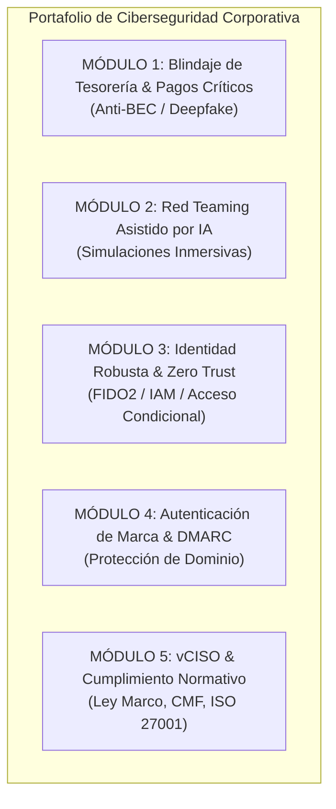
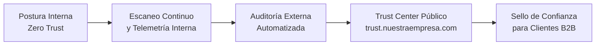
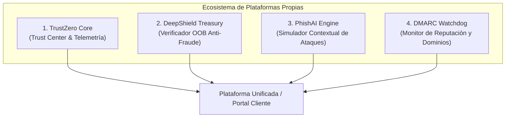
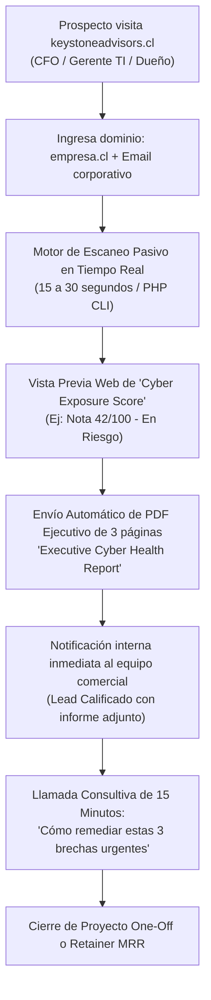

# 🛡️ DOCUMENTO FUNCIONAL Y ESTRATÉGICO
## SERVICIOS DE CIBERSEGURIDAD CORPORATIVA AVANZADA & BLINDAJE CONTRA AMENAZAS ASISTIDAS POR IA (AI-DRIVEN CYBERSECURITY)

---

## 1. RESUMEN EJECUTIVO Y MODELO DE NEGOCIO

### 1.1 Contexto de Mercado
El surgimiento de la Inteligencia Artificial Generativa ha transformado radicalmente el panorama de ciberamenazas. Los vectores tradicionales de ataque han mutado hacia mecanismos hiperpersonalizados, indetectables para los filtros convencionales: clonación de voz en tiempo real (*Vishing*), suplantación de directivos (*Business Email Compromise* - BEC), correos contextuales sin errores sintácticos y evasión autónoma de defensas. 

Las empresas medianas y grandes no cuentan con el tiempo ni los recursos especializados para adaptar sus operaciones de tesorería y TI a este nuevo paradigma. Esta propuesta define una **oferta de servicios B2B de alto valor añadido** orientada a proteger el flujo financiero, la reputación corporativa y la continuidad operativa de los clientes, respaldada por un **modelo riguroso de auto-monitoreo interno ("Casa de Cristal / Dogfooding")** que valida nuestra solvencia técnica y reputacional en el mercado.

### 1.2 Estructura de Ingresos (Funnel de Monetización)
1. **Punta de Lanza / Gancho (Quick-Win):** *Executive Cyber Risk Assessment* (Auditoría externa pasiva y diagnóstico de superficie de ataque en 72 horas).
2. **Proyectos de Implementación (One-Off de Alto Valor):** Remediaciones de arquitectura Zero Trust, blindaje de tesorería, DMARC e infraestructura de identidad robusta.
3. **Servicios Gestionados Recurrentes (MRR / Retainers):** Monitoreo continuo, simulaciones periódicas con IA, vCISO (Chief Information Security Officer virtual) y soporte de respuesta a incidentes.

---

## 2. CATÁLOGO FUNCIONAL DE SERVICIOS COMERCIALES (OFERTA EXTERNA)

### 2.1 Módulo 1: Blindaje Operativo de Tesorería y Pagos Críticos (Anti-BEC & Deepfake Shield)
* **Objetivo:** Prevenir desvíos de fondos, pagos fraudulentos y estafas de cambio de cuenta corriente bancaria ejecutadas mediante ingeniería social con IA.
* **Componentes Funcionales:**
  * **Protocolo de Validación Fuera de Banda (OOB - Out of Band):** Diseño e implementación de matrices de autorización obligatorias para pagos sobre un umbral determinado (ej. > \$2.000.000 CLP / USD \$2.500). Toda modificación de datos bancarios de proveedores o directivos exige verificación por canal alternativo preacordado (llamada a teléfono fijo verificado o tokenización criptográfica).
  * **Control Dual y Separación de Funciones:** Configuración y auditoría en portales bancarios de la empresa para separar los roles de "Creador de Lotes/Nóminas" y "Firmante/Aprobador".
  * **Validación Automatizada de Proveedores:** Scripting o integración API para contrastar facturas recibidas contra bases de datos tributarias oficiales y validar que la cuenta de depósito corresponda al RUT/tax ID del emisor legal.

### 2.2 Módulo 2: Simulaciones Avanzadas de Ataques Basados en IA (Human Red Teaming)
* **Objetivo:** Medir y elevar la tasa de resiliencia del personal clave (Finanzas, Compras, RRHH, Directorio) ante ataques de última generación.
* **Componentes Funcionales:**
  * **Campañas de Phishing Asistidas por IA:** Pruebas controladas con correos redactados mediante LLMs que incorporan contexto real y público de la empresa (contratos ganados, nombres de clientes reales, noticias de prensa), superando los tests genéricos de plantilla.
  * **Simulación Controlada de Vishing (Voz Sintética):** Pruebas de llamada telefónica programada simulando la voz clonada de un directivo o auditor que solicita una acción de emergencia.
  * **Tablero Ejecutivo de Resiliencia:** Métricas de apertura, clics, reporte oportuno y vulnerabilidad por departamento para comités de riesgo y directorios.

### 2.3 Módulo 3: Arquitectura de Identidad Robusta y Zero Trust (IAM / MFA FIDO2)
* **Objetivo:** Erradicar la efectividad de las credenciales robadas y el bypass de autenticación por SMS o códigos OTP tradicionales.
* **Componentes Funcionales:**
  * **Despliegue de Llaves Físicas FIDO2 / WebAuthn (YubiKeys / Passkeys):** Autenticación criptográfica resistente al intermediario (*phishing-resistant*) para usuarios con acceso a cuentas bancarias, ERP, repositorios de código y servidores cloud.
  * **Acceso Condicional (Conditional Access):** Políticas en Microsoft Entra ID / Google Workspace / Okta para restringir accesos según ubicación geográfica, cumplimiento del endpoint (antivirus/EDR activo) y nivel de riesgo de la sesión.
  * **Gestión de Accesos Privilegiados (PAM):** Cero contraseñas compartidas; implementación de bóvedas seguras con rotación automática de claves maestras.

### 2.4 Módulo 4: Protección de Identidad de Marca y Gobernanza de Correo (DMARC, DKIM, SPF)
* **Objetivo:** Impedir que ciberdelincuentes utilicen los dominios de la empresa para enviar correos suplantados a bancos, proveedores o clientes.
* **Componentes Funcionales:**
  * **Implementación de DMARC en modo estricto (`p=reject`):** Auditoría exhaustiva de emisores legítimos (CRM, ERP, marketing, soporte) y configuración de registros criptográficos SPF y DKIM.
  * **Monitoreo Continuo de Reportes RUA/RUF:** Detección en tiempo real de intentos de suplantación en cualquier parte del mundo.
  * **BIMI (Brand Indicators for Message Identification):** Despliegue de certificados VMC para mostrar el logotipo verificado de la empresa en bandejas de entrada corporativas.

### 2.5 Módulo 5: vCISO & Cumplimiento Normativo (Compliance & Incident Response)
* **Objetivo:** Proporcionar liderazgo estratégico de seguridad y alineación regulatoria sin el coste de un CISO a tiempo completo.
* **Componentes Funcionales:**
  * **Alineación con la Ley Marco de Ciberseguridad y Normativas CMF:** Clasificación de activos esenciales, reporte de incidentes y elaboración de planes de contingencia según el estándar legal exigido.
  * **Plan de Continuidad de Negocio (BCP) y Recuperación ante Desastres (DRP):** Pruebas periódicas de respaldos aislados (*Air-Gapped*) para mitigar ataques de Ransomware con IA.
  * **Gabinete de Crisis e Intervención:** Asistencia 24/7 en caso de incidente de seguridad confirmado.

---

## 3. EL PILAR DE CREDIBILIDAD: PROGRAMA INTERNO "TRUSTZERO" (AUTO-MONITOREO)

> *“Para proteger a terceros, debemos operar bajo los estándares más exigentes del mercado en nuestra propia infraestructura.”*

Para que las empresas grandes y comités de auditoría confíen en nosotros, implementaremos un marco interno de **Auto-Monitoreo y Transparencia Continua** (*Dogfooding*):

### 3.1 Arquitectura del Programa de Auto-Monitoreo
1. **Trust Center Institucional (`trust.nuestraempresa.com`):**
   * Portal público/privado con telemetría en tiempo real sobre la postura de seguridad de nuestra empresa.
   * Estado de cumplimiento normativo (ISO 27001 / SOC 2 / Ley Marco).
   * Verificación en vivo de registros DMARC (`p=reject`), cifrado TLS 1.3 y tiempo de actividad de servicios.
2. **Defensa Interna Phishing-Resistant:**
   * El 100% de los colaboradores de nuestra empresa utiliza llaves FIDO2 de hardware obligatorias para acceder a cualquier servicio o repositorio.
   * Prohibición absoluta de 2FA por SMS o llamadas de voz en cuentas internas.
3. **Control Criptográfico de la Cadena de Suministro de Software (DevSecOps):**
   * Firma digital obligatoria de commits en Git mediante claves GPG / SSH vinculadas a hardware.
   * Análisis estático (SAST) y de composición de software (SCA) automatizado en los pipelines de CI/CD para bloquear cualquier vulnerabilidad o credencial expuesta antes del despliegue.
4. **Auditoría Continua de Exposición Externa:**
   * Escaneo semanal automático de nuestros propios dominios y subdominios.
   * Monitoreo activo de credenciales corporativas en fuentes de Dark Web y filtraciones públicas.
5. **Políticas de Tesorería de Espejo:**
   * La misma política de validación telefónica/OOB y control dual que vendemos a los clientes es aplicada de forma estricta e inviolable en nuestra propia administración y facturación.

---

## 4. STACK DE HERRAMIENTAS Y PLATAFORMAS A DESARROLLAR (SOFTWARE PROPIO / IP)

Para maximizar el margen operativo, evitar depender exclusivamente de software de terceros y generar **activos de propiedad intelectual (IP) con valoración de mercado**, nuestra empresa debe desarrollar 4 herramientas modulares clave:

### 4.1 Herramienta 1: `TrustZero Core` (Portal de Confianza y Telemetría en Tiempo Real)
* **Tipo:** Web Application (SaaS Multi-tenant / White-label).
* **Propósito:** Alojar nuestro *Trust Center* interno (`trust.nuestraempresa.com`) y ofrecerle a clientes medianos/grandes su propio Trust Center corporativo para que lo presenten ante sus auditores, bancos y aseguradoras.
* **Módulos Técnicos a Programar:**
  * **Motor de Escaneo Periódico de Endpoints & Dominios:** Worker asíncrono (Node/Go/PHP) que verifica certificados SSL/TLS, cabeceras HTTP de seguridad (HSTS, CSP), versiones expuestas y registros DNS.
  * **Monitor de Estado de Cumplimiento:** Dashboard tipo semáforo donde se cargan evidencias y checklists vinculados a ISO 27001, Ley Marco y SOC 2.
  * **Generador de Sellos y Badges Dinámicos:** Widget SVG/JavaScript embebible en los sitios web de los clientes que valida en tiempo real: *"Security Posture Verified by TrustZero"*.

### 4.2 Herramienta 2: `DeepShield Treasury` (Microservicio de Verificación Fuera de Banda - OOB)
* **Tipo:** API REST + Webhook + Mini Web App móvil segura (PWA).
* **Propósito:** El motor que blinda los pagos corporativos contra estafas por voz clonada (Vishing) o correos falsos (BEC).
* **Módulos Técnicos a Programar:**
  * **Verificador Criptográfico de Pagos:** Cuando Tesorería recibe una orden de pago crítica o un aviso de "cambio de cuenta bancaria de proveedor", el sistema genera un enlace efímero con firma criptográfica tokenizada.
  * **Flujo de Aprobación Biométrica / WebAuthn:** El proveedor o el directivo firmante debe abrir el link en su smartphone y validar la orden usando huella/FaceID (WebAuthn) o respondiendo a un desafío criptográfico preacordado, anulando cualquier audio o correo sintético.
  * **Registro Inmutable de Auditoría:** Log con sellado de tiempo (timestamping) de cada intento de pago, IP, dispositivo y resultado para trazabilidad legal y tributaria.

### 4.3 Herramienta 3: `PhishAI Engine` (Generador de Simulaciones Inmersivas con LLM)
* **Tipo:** Backend de automatización con agentes de IA (Python / FastAPI + integración LLM).
* **Propósito:** Generar campañas de simulación de ingeniería social hiperpersonalizadas sin esfuerzo manual.
* **Módulos Técnicos a Programar:**
  * **Módulo OSINT Contextual:** Ingesta información pública del cliente objetivo (noticias de la empresa, licitaciones en Mercado Público, publicaciones de LinkedIn, nombres de directores) para alimentar el prompt del LLM.
  * **Generador Dinámico de Vectores:** La IA produce variantes de correos altamente persuasivos (ej. *"Actualización urgente de retención tributaria F29"*, *"Revisión de contrato marco de soporte IT"*).
  * **Servidor de Trampas / Honeypot Tracker:** Registra métricas de apertura, descarga de adjuntos simulados e ingreso de credenciales falsas en páginas clones de phishing controladas.
  * **Módulo de Feedback Instantáneo:** Si el empleado cae, la pantalla le muestra inmediatamente un micro-entrenamiento de 45 segundos explicando exactamente qué señales del correo indicaban un vector de ataque.

### 4.4 Herramienta 4: `DMARC Watchdog & Surface Scanner`
* **Tipo:** Daemon de ingesta de correo (XML Parser) + Scanner de puertos y DNS.
* **Propósito:** Resolver la complejidad de los reportes DMARC agregados (RUA) y traducirlos a gráficos claros para directivos.
* **Módulos Técnicos a Programar:**
  * **DMARC XML Ingestion Engine:** Recibe los reportes diarios enviados por Google, Microsoft, Yahoo y bancos mundiales en formato XML/GZIP y los procesa en base de datos.
  * **Clasificador de Fuentes Legítimas vs. Spoofing:** Identifica automáticamente si un servidor no autorizado intentó suplantar el dominio de la empresa y ubica geográficamente la IP atacante.
  * **Alertas Inmediatas vía Webhook:** Notificación por Slack, Teams o WhatsApp si se detecta un pico de correos maliciosos suplantando el dominio del cliente.

---

## 5. ESTRATEGIA COMERCIAL & MOTOR DE ADQUISICIÓN: ESCÁNER GRATUITO (PRODUCT-LED GROWTH)

Para evitar la fricción de la prospección en frío y generar autoridad inmediata ante directivos (CFOs, Gerentes de TI y Gerentes Generales), se implementa un **motor automatizado de escaneo pasivo y generación instantánea de informes ejecutivos**.

### 5.1 Reglas del Escaneo Pasivo (100% Legal y No Intrusivo)
* **Principio de No Invasión:** El escaneo opera exclusivamente sobre registros públicos (DNS, cabeceras HTTP de respuesta, certificados SSL/TLS y bases de datos públicas de incidentes). No ejecuta pruebas de penetración activas, inyecciones de código ni escaneo agresivo de puertos, garantizando **cero riesgo legal y sin requerir autorizaciones previas**.
* **Dimensiones Evaluadas en 20 Segundos:**
  1. **Blindaje de Correo e Identidad de Dominio:** Verificación de registros DMARC (`none` vs `quarantine` vs `reject`), alineación SPF y registros DKIM públicos. Mide la facilidad con que un atacante puede suplantar la identidad de la empresa ante bancos o proveedores.
  2. **Cifrado y Postura Web Pública:** Evaluación de certificados SSL/TLS, soporte de protocolos antiguos inseguros (TLS 1.0/1.1) y presencia de cabeceras de endurecimiento (HSTS, CSP, X-Frame-Options).
  3. **Superficie de Exposición Externa:** Detección de subdominios comunes de desarrollo o staging expuestos (`dev.empresa.cl`, `vpn.empresa.cl`, `test.empresa.cl`).
  4. **Fuga de Credenciales Históricas:** Consulta a repositorios seguros de filtraciones de datos corporativos conocidos.

### 5.2 Estructura del Entregable: "Executive Cyber Health Report" (PDF de 3 Páginas)
* **Página 1: Resumen Ejecutivo y Nivel de Exposición Financiera**
  * Puntuación de 0 a 100 con semáforo corporativo (Crítico / Alto / Moderado / Seguro).
  * Impacto de negocio proyectado: riesgo de fraude en tesorería por IA, probabilidad de suplantación y exposición a sanciones según la Ley Marco de Ciberseguridad.
* **Página 2: Radiografía Técnica de las 3 Principales Brechas**
  * Evidencia directa y comprensible para no técnicos (ej. *"Cualquier persona puede emitir correos desde tu dominio debido a DMARC desconfigurado"*).
  * Estado de las cabeceras y seguridad perimetral.
* **Página 3: Plan de Remediación Priorizado & Llamado a la Acción (CTA)**
  * Matriz de remediación inmediata recomendada (plazo sugerido: < 15 días).
  * Botón/enlace interactivo: **"Agendar Sesión Ejecutiva de Remediación de 20 min con un Especialista de Keystone Advisors"**.

### 5.3 Modelo Operativo de Atención Comercial (SLA y Roles)

| Etapa | Responsable | Acción Operativa | Tiempo de Respuesta |
| :--- | :--- | :--- | :--- |
| **1. Ingesta del Lead** | Sistema Web (Automático) | El prospecto pide el escaneo. El sistema genera el PDF y se lo envía a su email corporativo. | Inmediato (< 1 minuto) |
| **2. Alerta Comercial** | Webhook / Notificación | Se envía alerta a Slack/WhatsApp comercial: *"Lead de Empresa ABC (500 empleados), Score 42/100. Contacto: Juan Pérez (Gerente Finanzas)"*. | Inmediato |
| **3. Prospección Activa** | SDR / Ejecutivo Comercial | Si el prospecto no agenda solo en 24h, el ejecutivo lo contacta: *"Hola Juan, vimos el escaneo de tu dominio empresa.cl y notamos que el 100% de tus correos pueden ser suplantados por IA. Queríamos ofrecerte 15 minutos para explicarte cómo cerrarlo sin costo adicional."* | < 24 horas |
| **4. Sesión Consultiva** | Consultor Senior Keystone | Videollamada de 20 minutos revisando el reporte y presentando la cotización del proyecto de remediación. | Según agenda |
| **5. Cierre y Onboarding** | Equipo Keystone | Firma de orden de servicio e inicio del despliegue de las herramientas Keystone (DMARC Watchdog + DeepShield Treasury). | 48 - 72 horas |

---

## 6. HOJA DE RUTA DE LANZAMIENTO (ROADMAP DE 90 DÍAS)

| Fase | Plazo | Hitos Principales | Entregables Clave |
| :--- | :--- | :--- | :--- |
| **Fase 1: Blindaje Interno** | Días 1 - 30 | • Despliegue de FIDO2 interno. • Auditoría DMARC `p=reject` en nuestros dominios. • Creación del *Trust Center*. | Sello "TrustZero Verified" interno y manual de políticas de tesorería propia. |
| **Fase 2: Empaquetamiento Comercial** | Días 31 - 60 | • Creación de plantillas de *Executive Cyber Assessment*. • Plataforma de simulación de Phishing/Vishing con IA configurada. • Definición de listas de precios y contratos de servicio tipo. | Deck comercial B2B, calculadora de ROI para clientes y modelo de contrato SLA. |
| **Fase 3: Campaña de Prospección** | Días 61 - 90 | • Campaña de prospección a CFOs, Gerentes de TI y Gerentes Generales. • Ejecución de 5 Assessments de diagnóstico gratuitos (gancho). • Cierre de los primeros 2 proyectos de blindaje de tesorería y retención MRR. | Primeros casos de éxito publicados y contratos recurrentes activos. |

---

## 5. IMPACTO EN EL CLIENTE Y VALOR DIFERENCIAL

* **Para el CFO / Gerente de Finanzas:** Cero riesgo de transferencias erróneas o estafas millonarias por suplantación con IA; blindaje de responsabilidades legales.
* **Para el CIO / Gerente de TI:** Un aliado especializado que asume la carga técnica de identidad, DMARC y pruebas de estrés humano sin saturar a su equipo interno.
* **Para el Directorio:** Métricas cuantificables de reducción de riesgo, cumplimiento de las nuevas leyes de ciberseguridad y protección del patrimonio de la empresa.
