# 🚀 SinNotario.cl — Documento de Diseño Funcional, Técnico y Modelo Híbrido

> **Cliente / Proyecto:** Keystone Advisors — `SinNotario.cl`  
> **Tipo de Solución:** SaaS Legaltech + Red de Oficinas Físicas y Asesoría Legal Presencial  
> **Benchmarking Directo:** MuySimple.cl y DocLegal.cl (Chile)  
> **Marco Regulatorio:** Ley N° 19.799 (Firma Electrónica) / Ley N° 21.461 ("Devuélveme mi casa")  
> **Estado:** Documento Vivo de Trabajo (Versión 1.0)

---

## 📑 Tabla de Contenidos
1. [Introducción y Visión del Negocio](#1-introducción-y-visión-del-negocio)
2. [Benchmarking Exhaustivo de Referentes](#2-benchmarking-exhaustivo-de-referentes)
   - [2.1 Análisis de MuySimple.cl](#21-análisis-de-muysimplecl)
   - [2.2 Análisis de DocLegal.cl](#22-análisis-de-doclegalcl)
   - [2.3 Matriz Comparativa y Diferenciación Estratégica](#23-matriz-comparativa-y-diferenciación-estratégica)
3. [Arquitectura Funcional del Software](#3-arquitectura-funcional-del-software)
   - [3.1 Módulo 1: Motor de Plantillas Inteligentes y Asistente IA](#31-módulo-1-motor-de-plantillas-inteligentes-y-asistente-ia)
   - [3.2 Módulo 2: Circuito de Firmas e Integración de Identidad Digital](#32-módulo-2-circuito-de-firmas-e-integración-de-identidad-digital)
   - [3.3 Módulo 3: Pasarela de Pagos y Notificaciones Omnicanal](#33-módulo-3-pasarela-de-pagos-y-notificaciones-omnicanal)
   - [3.4 Módulo 4: Verificación Pública y Trazabilidad](#34-módulo-4-verificación-pública-y-trazabilidad)
   - [3.5 Módulo 5: Backend Administrativo y Consola de Configuración de la Plataforma](#35-módulo-5-backend-administrativo-y-consola-de-configuración-de-la-plataforma)
   - [3.13 Módulo 13: Motor de Facturación Electrónica Automática SII (Boletas y Facturas DTE)](#313-módulo-13-motor-de-facturación-electrónica-automática-sii-boletas-y-facturas-dte)
   - [3.14 Módulo 14: Infraestructura de Correo Transaccional Oficial (Titan Mail SMTP & Casillas Operativas)](#314-módulo-14-infraestructura-de-correo-transaccional-oficial-titan-mail-smtp--casillas-operativas)
   - [3.15 Módulo 15: Suite de Inteligencia Financiera, Control de Costos de Firma y Conciliación Bancaria](#315-módulo-15-suite-de-inteligencia-financiera-control-de-costos-de-firma-y-conciliación-bancaria)
4. [Modelo Híbrido: Plataforma Digital + Oficina Física](#4-modelo-híbrido-plataforma-digital--oficina-física)
   - [4.1 Por qué una Oficina Física (Resolución de Brechas)](#41-por-qué-una-oficina-física-resolución-de-brechas)
   - [4.2 Servicios de la Oficina Física](#42-servicios-de-la-oficina-física)
   - [4.3 Flujo Operativo del Cliente en Sucursal](#43-flujo-operativo-del-cliente-en-sucursal)
   - [4.4 Servicio de Asesoría Legal Presencial](#44-servicio-de-asesoría-legal-presencial)
5. [Blindaje Legal y Mitigación de Riesgos](#5-blindaje-legal-y-mitigación-de-riesgos)
   - [5.1 Validez bajo la Ley N° 19.799](#51-validez-bajo-la-ley-n-19799)
   - [5.2 Mitigación de Riesgos Notariales (Código Orgánico de Tribunales)](#52-mitigación-de-riesgos-notariales-código-orgánico-de-tribunales)
   - [5.3 Catálogo de Documentos Válidos vs Excluidos](#53-catálogo-de-documentos-válidos-vs-excluidos)
   - [5.4 Protección de Marca en INAPI](#54-protección-de-marca-en-inapi)
6. [Roadmap de Implementación y Fases](#6-roadmap-de-implementación-y-fases)

---

## 1. Introducción y Visión del Negocio

El proyecto **SinNotario.cl** surge para eliminar la burocracia, tiempos de espera y costos excesivos de las notarías tradicionales en Chile. Basado en la **Ley N° 19.799** (Firma y Documentos Electrónicos), permite redactar y suscribir instrumentos privados con plena fuerza legal.

### Propuesta de Valor Diferencial (Omnicanal)
A diferencia de los portales 100% digitales existentes, SinNotario propone un **modelo híbrido disruptivo**:
* **SaaS de Autogestión 100% Online:** Para el usuario nativo digital que busca rapidez e inmediatez desde su hogar u oficina.
* **Red de Oficinas Físicas de Atención y Asesoría Legal:** Para personas con brecha digital, adultos mayores o clientes que requieren asistencia paso a paso, estaciones de firma presencial o el respaldo directo de un abogado.

---

## 2. Benchmarking Exhaustivo de Referentes

### 2.1 Análisis de MuySimple.cl
* **Enfoque de Producto:** Gran volumen en trámites sencillos y masivos: declaraciones juradas (residencia, mudanza, ingresos) y contratos de arriendo residenciales/comerciales.
* **Flujo de Usuario:** Asistente paso a paso (*wizard*) guiado por formulario web estandarizado.
* **Firma y Validación:** Uso de Firma Electrónica Simple (FES) y opciones de derivación a notarías en convenio para trámites presenciales.
* **Debilidad Detectada:** Experiencia fría y 100% transaccional. No resuelven cláusulas a la medida ni ofrecen asesoría legal personalizada ante dudas o conflictos.

### 2.2 Análisis de DocLegal.cl
* **Innovación Tecnológica:** Integra herramientas de Inteligencia Artificial para redactar escritos y adaptar contratos a partir de respuestas del usuario.
* **Modelo Tarifario:** Tarifa por firma fija (ej. $7.990 CLP para Firma Electrónica Avanzada) sin suscripciones mensuales forzadas.
* **Integración ClaveÚnica:** Emisión de Firma Electrónica Avanzada (FEA) validada mediante ClaveÚnica con Segundo Factor de Autenticación (2FA).
* **Flexibilidad Documental:** Permite subir documentos propios en formato PDF para someterlos a firma.
* **Soporte Legal:** Red de abogados especialistas (laboral, inmobiliario, familia, comercial) contactables vía WhatsApp/remoto.

### 2.3 Matriz Comparativa y Diferenciación Estratégica

| Capacidad Funcional | MuySimple.cl | DocLegal.cl | SinNotario.cl (Nuestra Solución) |
| :--- | :--- | :--- | :--- |
| **Redacción Guiada en Línea** | Formularios rígidos | Formularios + IA | **Formularios dinámicos + Asistente IA** |
| **Firma Electrónica Avanzada (FEA)** | Disponible | Disponible (ClaveÚnica) | **Disponible (ClaveÚnica + Biometría)** |
| **Carga de Archivos Propios (PDF)** | Limitada | Habilitada | **Totalmente Habilitada** |
| **Asesoría Jurídica con Abogados** | Inexistente / Externa | Remota (Chat/WhatsApp) | **Omnicanal: Remota + En Oficina Física** |
| **Oficina Física de Atención** | ❌ No tiene | ❌ No tiene | **✅ Sucursales de Atención Presencial** |
| **Soporte para Brecha Digital** | Nula (100% autogestión) | Baja (Soporte chat) | **Total (Digitación asistida y tótems)** |
| **Copias Físicas Certificadas** | ❌ No disponible | ❌ No disponible | **✅ Entrega física con QR y sellos de seguridad** |

---

## 3. Arquitectura Funcional del Software

### 3.1 Módulo 1: Motor de Plantillas Inteligentes y Asistente IA
* **Catálogo Organizado por Áreas:**
  * *Inmobiliario:* Arriendos (bajo Ley Devuélveme mi Casa), subarriendos, promesas de compraventa, entrega de llaves.
  * *Laboral:* Contratos de trabajo, anexos de teletrabajo/jornada, cartas de término, finiquitos de mutuo acuerdo.
  * *Comercial:* Prestación de servicios profesionales, acuerdos NDA, cesión de derechos, convenios de pago.
  * *Personales:* Declaraciones juradas de residencia, mudanza, poderes simples, autorizaciones de viaje nacional.
* **Motor de Renderizado Dinámico:** Inyección en tiempo real de placeholders semánticos (`{{NOMBRE}}`, `{{RUT}}`, `{{CANON}}`, `{{DIRECCION}}`), con validación de RUT chileno (módulo 11) y visor PDF interactivo previo al pago.
* **Asistente de IA Legal:** Permite al usuario indicar requisitos especiales (ej. "incluir garantía en cuotas y reajuste trimestral en IPC") y redactar la cláusula sin alterar el blindaje legal del documento.

### 3.2 Módulo 2: Circuito de Firmas e Integración Técnica con IDOK (FirmaYa)

Para garantizar la máxima validez jurídica bajo la **Ley N° 19.799** con costos de entrada controlados, **SinNotario.cl** se conecta mediante **API REST** con **IDOK (FirmaYa / BeTrust)**, prestador de servicios de certificación acreditado ante el Ministerio de Economía.

#### A. Flujo de Integración Criptográfica y UX del Firmante
El flujo técnico se ejecuta de manera desacoplada y asíncrona para ofrecer una experiencia fluida al usuario final:

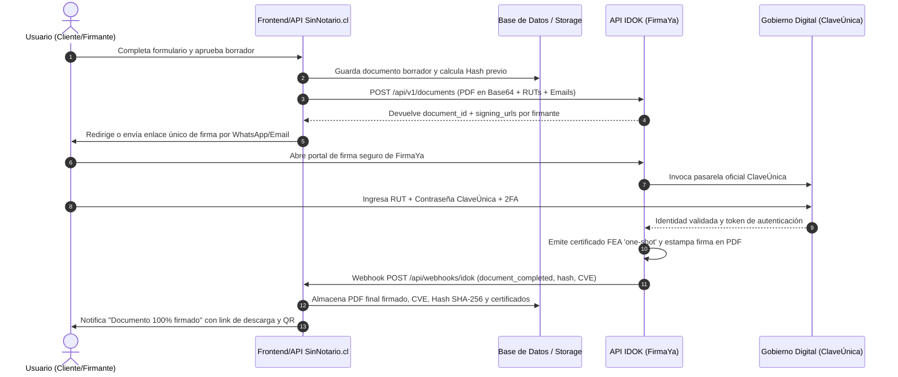

#### B. Especificación de Endpoints del Adaptador de Integración (`IdokSignAdapter`)
En la capa backend de SinNotario (siguiendo el estándar de arquitectura modular de Keystone Advisors), se crea un adaptador dedicado con los siguientes contratos:

1. **`POST /api/v1/documents` (Despacho a Firma):**
   * **Headers:** `Authorization: Bearer {IDOK_API_KEY}`, `Content-Type: application/json`.
   * **Payload enviado por SinNotario:**
     ```json
     {
       "title": "Contrato de Arriendo - Folio SN-2026-9842",
       "file_base64": "JVBERi0xLjQKJ...",
       "signature_type": "FEA",
       "authentication_method": "CLAVE_UNICA_2FA",
       "signers": [
         {
           "rut": "12345678-9",
           "name": "Juan Pérez González",
           "email": "juan.perez@email.cl",
           "phone": "+56912345678",
           "order": 1,
           "role": "Arrendador"
         },
         {
           "rut": "16789012-3",
           "name": "María Soto Morales",
           "email": "maria.soto@email.cl",
           "phone": "+56987654321",
           "order": 2,
           "role": "Arrendatario"
         }
       ],
       "webhook_url": "https://sinnotario.cl/api/webhooks/idok",
       "metadata": {
         "internal_folio": "SN-2026-9842-AF7C"
       }
     }
     ```
   * **Respuesta recibida:**
     ```json
     {
       "success": true,
       "document_id": "idok_doc_89432174",
       "status": "pending_signatures",
       "signers": [
         {
           "rut": "12345678-9",
           "signing_url": "https://firmaya.cl/sign/token_alpha_1"
         },
         {
           "rut": "16789012-3",
           "signing_url": "https://firmaya.cl/sign/token_alpha_2"
         }
       ]
     }
     ```

2. **`POST /api/webhooks/idok` (Receptor Asíncrono de Eventos):**
   * Endpoint protegido por firma HMAC en el encabezado `X-Idok-Signature` para certificar procedencia.
   * Maneja eventos:
     * `signer_signed`: Un firmante completó su paso; se actualiza el tracker visual en el dashboard de SinNotario.
     * `document_completed`: Todos los firmantes completaron el flujo. El webhook entrega el `pdf_signed_url`, el código CVE (`validador.firmaya.cl`) y el sello de tiempo TSA.
     * `document_rejected`: Si alguna de las partes rechaza o expira el plazo de firma.

3. **`GET /api/v1/documents/{document_id}/download`:**
   * Descarga segura y persistencia en almacenamiento cifrado local/S3 del documento con su estampa criptográfica y cadena X.509.

#### C. Integración en el Diseño Frontend del Sitio Web (`sinnotario.cl`)
1. **Paso a Paso Transparente:**
   * En el paso 3 del flujo de compra ("Firmantes"), el sitio muestra claramente:
     > 🛡️ **Validación de Identidad Segura:**  
     > *Este documento será firmado con **Firma Electrónica Avanzada (FEA)** acreditada. Cada firmante recibirá un enlace seguro y validará su identidad con su **ClaveÚnica del Estado** o cédula de identidad.*
2. **Visualizador de Estado de Firmas en Tiempo Real (Tracker):**
   * Un panel tipo línea de tiempo donde el usuario ve:
     * 🟢 *Arrendador:* Juan Pérez — Firmado con ClaveÚnica (06/11/2026 10:15).
     * 🟡 *Arrendatario:* María Soto — Pendiente de firma (Enlace enviado por WhatsApp).
     * Botón: `Reenviar Recordatorio por WhatsApp`.
3. **Sellos de Confianza en el Footer del Sitio Web:**
   * Inclusión en el footer y checkout de los sellos visuales:
     * Logotipo oficial de **ClaveÚnica (Gobierno Digital)**.
     * Sello de certificación **IDOK (Prestador Acreditado)**.
     * Mención explícita: *"Cumplimiento Ley N° 19.799 sobre Documentos Electrónicos"*.

### 3.3 Módulo 3: Estrategia de Medios de Pago (Web vs. Presencial) y Optimización Financiera

Para maximizar el margen de ganancia de **SinNotario.cl** y garantizar una tasa de conversión de cobro superior al 95%, la plataforma implementa una estrategia diferenciada de pasarelas de pago según el canal:

#### A. Canal Autoatención Web: Comparativa y Selección Óptima

| Pasarela Web | Débito / Prepago | Crédito | Plazo de Abono | Análisis de Conveniencia para SinNotario.cl |
| :--- | :--- | :--- | :--- | :--- |
| **Webpay Plus (Transbank)** | **1,49% + IVA** | **2,29% + IVA** | 24 a 48 hrs hábiles | 🏆 **Recomendada #1 como pasarela principal de tarjetas.** La comisión más baja del mercado chileno y la que genera mayor confianza en el consumidor local. |
| **Fintoc (Open Banking)** | **1,0% a 1,3% + IVA** (Fija/Baja) | Transferencias cuenta a cuenta | **Inmediato (Banco a Banco)** | 🏆 **Recomendada #1 para optimización de margen.** El usuario paga transfiriendo directo desde su Banco (BancoEstado, Santander, Chile, etc.) sin usar tarjeta. Cero riesgo de contracargos (*chargebacks*) y costo financiero mínimo. |
| **Mercado Pago** | 3,19% + IVA (inmediato) / 2,89% (10 días) | 3,19% / 2,89% | Inmediato o 10 días | Útil como alternativa secundaria de respaldo si falla Webpay o para clientes que pagan con saldo en su billetera Mercado Pago. |
| **Flow** | 2,89% a 3,19% + IVA | 2,89% a 3,19% + IVA | 1 a 3 días hábiles | Agregador cómodo pero más caro que la integración directa de Webpay + Fintoc. |

**Arquitectura Web Recomendada en Checkout:**
* **Opción Preferente:** **Transferencia Bancaria Rápida (Fintoc)** con incentivo de marketing (ej: *"Paga con transferencia directa y tu documento se procesa al instante sin comisiones"*). Nos ahorra casi un 50% de comisión respecto a tarjetas de crédito.
* **Opción Tradicional:** **Webpay Plus** para todo el universo de tarjetas de débito y crédito.
* **Notificaciones Automatizadas:** Despacho transaccional en tiempo real vía WhatsApp Business API y correo electrónico tras confirmación de pago.

---

#### B. Canal Presencial en Sucursal: Comparativa y Selección Óptima de Terminales POS

En el local físico, el cobro se realiza en el mesón de atención para emitir el Ticket con PIN/QR que desbloquea la firma:

| Dispositivo POS Presencial | Modelo de Costo | Comisión Débito | Comisión Crédito | Plazo de Abono | Conveniencia para Sucursal SinNotario |
| :--- | :--- | :--- | :--- | :--- | :--- |
| **Súper Compraquí (BancoEstado)** | **Sin Arriendo Mensual** (Compra única del equipo ~$159k) | **1,29% + IVA** | **1,59% + IVA** | **El mismo día** (a cuentas BancoEstado) | 🏆 **La opción más rentable para arrancar.** No genera costos fijos si el local está en marcha blanca, tiene la comisión más baja de Chile en crédito (1,59%) e incluye impresora térmica integrada para sacar el ticket con PIN en el acto. |
| **POS Transbank / Smart POS** | **Arriendo Mensual** (~0,35 a 0,45 UF/mes + IVA) | 1,49% + IVA | 2,29% + IVA | 24 a 48 hrs hábiles | Ideal a partir de Fase 3 cuando la sucursal supere las 800 - 1.000 transacciones mensuales y el costo del arriendo se diluya. |
| **Getnet (Santander)** | Arriendo Mensual (~0,39 UF/mes) | 1,50% - 1,77% + IVA | 2,6% - 2,8% + IVA | El mismo día (si cuenta es Santander) | Excelente si la cuenta principal de Keystone Advisors es Santander y se requiere abono inmediato en el día. |
| **SumUp (Air / Solo)** | Sin Arriendo (Compra única) | 2,90% + IVA | 2,90% + IVA | 1 a 2 días hábiles | Descartado como equipo principal por tener comisiones muy altas (2,9% plano); solo como backup de emergencia. |

**Estrategia Presencial Recomendada:**
1. **Terminal Principal en Mesón:** **Súper Compraquí (BancoEstado)** o **Smart POS (Getnet/Santander)**: Dispositivo autónomo con pantalla táctil, chip 4G propio e impresora de recibos incorporada donde sale el **Ticket de Firma con el PIN y Código QR**.
2. **Caja Tradicional:** Posibilidad de recibir **Efectivo** o **Transferencia directa a la cuenta de Keystone Advisors** con validación en el sistema.

### 3.5 Módulo 5: Sistema de Asistencia Contextual Inteligente y Escalado Humano en Un Clic ("Anti-Frustración")

Uno de los principales dolores en las plataformas legaltech de autoatención (como *DocLegal* o *MuySimple*) es que cuando el usuario enfrenta una duda jurídica cotidiana —por ejemplo, **cómo firma una empresa con representante legal**, **cuántas firmas debe comprar si comparecen cónyuges**, o qué pasa si un firmante no tiene ClaveÚnica—, el soporte suele ser un chatbot rígido que responde textos genéricos o un formulario de correo que tarda 24 horas en responder.

En **SinNotario.cl** diseñamos un sistema de **Asistencia Contextual Activa** y un canal de **Escalado Humano Inmediato en Un Clic** concebido bajo tres pilares:

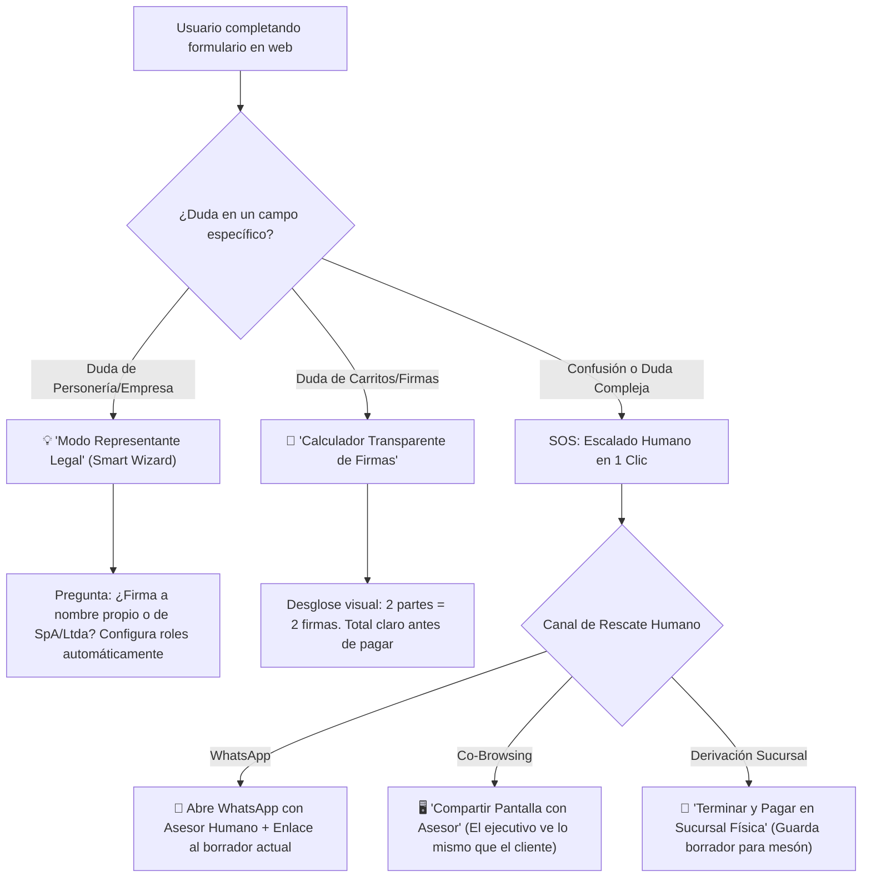

---

#### A. Resolución de Dudas Complejas Mediante UX Inteligente (Micro-Guías Contextuales)

1. **El Caso Crítico: Representante Legal de Empresa (Persona Jurídica):**
   * **El problema habitual:** El cliente no sabe si poner el RUT de su empresa o su RUT personal, ni si debe pagar una firma para él y otra para la empresa.
   * **La solución en SinNotario:** Selector inteligente en la cabecera del firmante:
     * `[ X ] Soy Persona Natural` / `[ X ] Comparezco como Representante Legal de una Empresa (SpA / Ltda / S.A.)`.
     * Al marcar *Representante Legal*, el formulario despliega dos sub-bloques claros con explicación visual:
       * **Datos de la Empresa Mandante:** Razón Social y RUT de la Empresa (ej: `Inversiones Keystone SpA - 77.123.456-7`).
       * **Datos de la Persona que Firma (Persona Natural):** Nombre y RUT personal del representante legal (quien usará su propia ClaveÚnica personal para firmar en representación de la sociedad).
       * **Tip Legal en pantalla:** *"💡 Recuerda: La ClaveÚnica es personal e intransferible. Tú firmas con tu RUT personal en tu calidad de representante legal acreditado de la empresa. No necesitas una ClaveÚnica para la empresa."*

2. **El Caso: Calculador Transparente de Firmas (Sin Sorpresas al Pagar):**
   * **El problema habitual:** El usuario compra 1 documento creyendo que incluye todas las firmas, y luego la plataforma le cobra extra por la contraparte o lo deja a mitad del trámite.
   * **La solución en SinNotario:** Caja resumen dinámica flotante en tiempo real:
     > 📋 **Tu Documento:** Contrato de Arriendo con Ley 21.461  
     > 👥 **Firmantes Requeridos (2):**  
     > • 1x Firma Arrendador (Don Juan)  
     > • 1x Firma Arrendatario (Doña María)  
     > 💰 **Total a Pagar:** 2 Firmas FEA = $15.980 CLP *(Sin cobros sorpresa posteriores)*.

---

#### B. Escalado Humano en Un Clic ("Botón de Rescate")

Si a pesar de las micro-guías el cliente se siente inseguro, la plataforma no lo encierra en un bot inútil:

1. **WhatsApp Ejecutivo con Contexto Compartido:**
   * Al pulsar el botón flotante **"Hablar con un Asesor Humano"**, no se abre un chat vacío.
   * El sistema genera un mensaje dinámico pre-armado:  
     > *"Hola, estoy en SinNotario.cl redactando un Contrato de Arriendo (Borrador #SN-9842) y tengo una duda sobre la cláusula de garantía. ¿Me pueden ayudar a completarlo?"*
   * El ejecutivo de turno de Keystone Advisors recibe el mensaje en su panel omnicanal junto con el enlace directo para inspeccionar el borrador que el usuario estaba editando.

2. **Asistencia Remota Asistida (Co-Browsing Seguro):**
   * El cliente puede pulsar **"Pedir ayuda guiada en pantalla"**.
   * El sistema genera un código de 4 dígitos. Al dárselo al ejecutivo telefónico o por WhatsApp, el ejecutivo puede ver en modo solo lectura la pantalla del cliente y guiarlo: *"Don Juan, en el campo 3 ingrese la fecha de inicio..."*. (El ejecutivo nunca puede ver contraseñas ni datos bancarios).

3. **El Puente hacia la Sucursal Física ("Termina tu trámite en Oficina"):**
   * Si el usuario se frustra o dice: *"Prefiero que alguien lo haga por mí"*, el sistema ofrece:
     > 🏢 **¿Prefieres que lo hagamos juntos en persona?**  
     > *Pulsa 'Guardar y Terminar en Sucursal'. Tu borrador quedará guardado con tu RUT. Acércate a cualquiera de nuestras oficinas físicas y un ejecutivo continuará tu trámite desde este mismo punto en nuestro mesón.*

Uno de los pilares más críticos para la confianza de terceros (bancos, municipalidades, juzgados, carabineros, conserjerías y corredoras de propiedades) es el **Módulo de Validación y Cotejo de Documentos en Tiempo Real**. Ningún documento tiene tracción en el mercado si quien lo recibe no puede comprobar de inmediato si el documento es auténtico o si fue alterado con un editor de PDF.

#### A. Arquitectura y Mecanismos de Validación (Doble Vía de Entrada)
El portal público accesible en **`sinnotario.cl/verificar`** (o subdominio `validador.sinnotario.cl`) ofrece dos métodos de verificación inmediata sin necesidad de registrarse ni iniciar sesión:

1. **Vía 1: Código Alfanumérico Único de Verificación (Token / FOLIO):**
   * Cada documento generado recibe un identificador único con checksum (ejemplo: `SN-2026-9842-AF7C`).
   * El tercero simplemente ingresa el código en la casilla de búsqueda del portal.
2. **Vía 2: Escaneo Directo de Código QR Dinámico:**
   * En el pie de página de cada hoja del PDF impreso o digital, se estampa un código QR que apunta directamente a:  
     `https://sinnotario.cl/verificar?doc=SN-2026-9842-AF7C&hash=7f83b165...`
   * Al escanear con la cámara del teléfono móvil, abre la pantalla de validación al instante.
3. **Vía 3: Cotejo Forense por Carga de Archivo PDF (Cálculo de Hash SHA-256):**
   * El tercero puede arrastrar y soltar el archivo PDF que recibió por correo.
   * El sistema calcula en cliente/servidor el hash criptográfico **SHA-256** del archivo y lo compara contra el hash original sellado en el momento de la firma.
   * **Detección de Manipulación:** Si alguien modificó una sola letra, un número de la renta o una fecha con Adobe Acrobat o Photoshop, el hash cambia y el sistema alerta de inmediato: *"ALERTA: El documento subido ha sido alterado y no coincide con el original firmado"*.

```mermaid
flowchart TD
    A["Tercero (Banco / Juzgado / Corredora)"] --> B{"Método de Verificación"}
    B -->|QR en Celular| C["Cámara lee QR en pie de página"]
    B -->|Ingreso Manual| D["Escribe Código Folio (SN-XXXX)"]
    B -->|Archivo Digital| E["Sube PDF para cotejo SHA-256"]
    
    C --> F["Portal sinnotario.cl/verificar"]
    D --> F
    E --> F
    
    F --> G["Motor de Verificación Criptográfica"]
    G --> H{"¿Documento Íntegro y Válido?"}
    H -->|SÍ (Coincide Hash)| I["✅ Pantalla de Validez Verde + Cadena de Firmantes + Descarga Original"]
    H -->|NO (Adulterado/Inexistente)| J["❌ Pantalla Roja de Alerta de Fraude / Documento Alterado"]
```

#### B. Información que Despliega la Pantalla Pública de Validación
Cuando el documento es legítimo, el validador muestra un certificado visual estructurado:
* 🟢 **Estado:** **DOCUMENTO VÁLIDO Y FIRMADO ELECTRÓNICAMENTE** (Sello Verde con Sello de Tiempo TSA).
* 📋 **Metadatos del Documento:**
  * Nombre del Instrumento: *Contrato de Arrendamiento con Mérito Ejecutivo (Ley 21.461)*.
  * Código de Folio: `SN-2026-9842-AF7C`.
  * Fecha y Hora exacta de cierre de firmas (Timestamp UTC-3 Chile).
  * Código Hash SHA-256 del documento final: `e3b0c44298fc1c149afbf4c8996fb92427ae41e4649b934ca495991b7852b855`.
* 👥 **Cadena de Custodia y Firmantes Identificados:**
  * **Compareciente 1 (Arrendador):** Juan Pérez González — RUT: 12.345.678-9 — *Validado con ClaveÚnica (2FA)* — Fecha: 06/11/2026 10:15:22.
  * **Compareciente 2 (Arrendatario):** María Soto Morales — RUT: 16.789.012-3 — *Validado con ClaveÚnica (2FA)* — Fecha: 06/11/2026 11:42:05.
  * **Certificador Acreditado:** Prestador de Servicios de Certificación Acreditado bajo la Ley N° 19.799.
* 📥 **Descarga Segura de Copia Fiel:** Opción para que el receptor autorizado descargue el PDF original inalterable para contrastarlo con la copia física en papel que tiene en sus manos.

#### C. Estampado Forense en el PDF (Pie de Página Institucional)
Todo documento emitido por SinNotario incluye en el pie de página de **todas y cada una de sus hojas**:
```text
┌────────────────────────────────────────────────────────────────────────────────────────────────────────┐
│  Documento firmado con Firma Electrónica Avanzada conforme a la Ley N° 19.799 (República de Chile).     │
│  Folio: SN-2026-9842-AF7C | Hash SHA-256: 7f83b165... | Verifique en: sinnotario.cl/verificar           │
│  [ QR CODE ] Escanee para validar la autenticidad, autoría e integridad de este documento en línea.    │
└────────────────────────────────────────────────────────────────────────────────────────────────────────┘
```

---

### 3.6 Módulo 6: Motor de Auditoría y Diagnóstico Legal Asistido por IA (`Smart Legal Check`) y Blindaje de Responsabilidad

Una de las funcionalidades de mayor valor agregado (y potencial monetización adicional o servicio freemium) es permitir que el cliente suba su propio documento en formato PDF y active voluntariamente el servicio:
> *"¿Quieres que nuestra Inteligencia Artificial Legal analice tu documento y te entregue consideraciones y alertas normativas antes de firmar?"*

Este motor contrasta el texto del PDF contra la legislación chilena vigente (Código Civil, Código del Trabajo, Ley N° 18.101 de Arrendamientos, Ley N° 21.461 "Devuélveme mi casa", Ley N° 19.496 del Consumidor, etc.) para detectar cláusulas abusivas, vacíos legales o requisitos solemnes que exigirían notario.

---

#### A. Arquitectura Técnica del Motor de Análisis Legal (RAG Normativo Chileno)

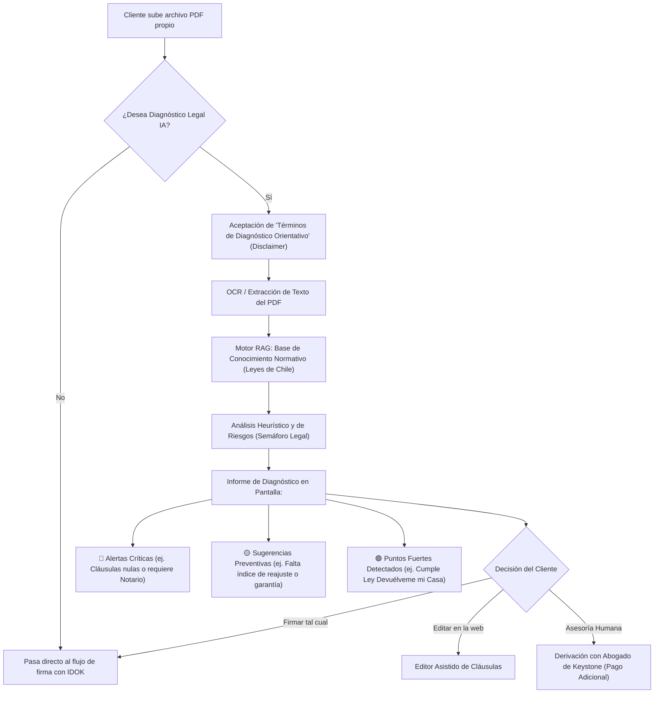

1. **Detección Automática de Invalidez Notarial (Filtro Preventivo):**
   * Si el PDF contiene palabras de escrituras solemnes (ej: *"compraventa de inmueble"*, *"autorización de salida de menor"*), el motor alerta en rojo:
     > 🛑 **ALERTA CRÍTICA:** *Este documento aparenta ser una compraventa de bien raíz. La ley chilena exige Escritura Pública ante Notario. Firmarlo electrónicamente provocará su nulidad absoluta en el Conservador.*
2. **Detección de Cláusulas Abusivas o Ineficaces:**
   * En arriendos: Alerta si falta la sumisión expresa al procedimiento monitorio de la Ley N° 21.461, o si se estipulan intereses usurarios por sobre el Máximo Convencional.
   * En contratos de trabajo: Alerta si hay cláusulas de renuncia anticipada a derechos laborales (irrenunciables según Art. 5° del Código del Trabajo).
3. **Semáforo Legal y Reporte Descargable:**
   * La plataforma entrega un informe estructurado en 3 niveles: 🔴 **Riesgos Altos**, 🟡 **Oportunidades de Mejora** y 🟢 **Aspectos Sólidos**.

---

#### B. La Pregunta Crítica: ¿Cómo nos Protegemos si el Cliente Culpa a SinNotario? (Blindaje Legal)

Si el sistema sugiere: *"Te sugerimos agregar que la garantía se devuelve en 30 días"* y luego las partes tienen un litigio en tribunales y el cliente argumenta: *"SinNotario me dijo que pusiera esa cláusula y por eso perdí el juicio"*, **la plataforma debe estar 100% blindada civil, penal y administrativamente (SERNAC)**.

Para ello, se implementa una **estrategia de blindaje en 4 capas legales**:

##### 1. El Consentimiento Expreso Previo ("Clickwrap Agreement Obligatorio")
Antes de que la IA procese una sola línea del PDF, aparece un modal con casilla de verificación obligatoria que el cliente debe marcar:
> `[ X ] He leído y acepto los Términos del Diagnóstico Automatizado de Inteligencia Artificial.`

##### 2. Redacción Taxativa del Disclaimer de Responsabilidad (El Escudo Legal)
En el modal, en el pie del informe y en los Términos y Condiciones se estipula la siguiente cláusula redactada bajo la doctrina chilena de **obligaciones de medio vs. resultado** y **autonomía de la voluntad**:

> **CLÁUSULA DE EXENCIÓN DE RESPONSABILIDAD Y NATURALEZA DEL DIAGNÓSTICO IA:**  
> *"El servicio 'Smart Legal Check' es una herramienta tecnológica automatizada de asistencia analítica y procesamiento de lenguaje natural basada en Inteligencia Artificial.  
> 1. **Naturaleza Meramente Orientativa:** Los hallazgos, alertas y consideraciones emitidas por la herramienta constituyen únicamente sugerencias referenciales y de carácter pedagógico, orientadas a facilitar la revisión de su documento.  
> 2. **No Constituye Asesoría Legal Vinculante:** Este análisis automatizado **no constituye asesoría legal profesional, patrocinio de abogado ni dictamen jurídico vinculante**. Las leyes y su interpretación judicial varían según los antecedentes de hecho de cada caso particular.  
> 3. **Decisión y Responsabilidad Exclusiva del Usuario:** La decisión de incorporar, modificar, eliminar o mantener cualquier cláusula en su documento es de exclusiva, libre y soberana responsabilidad del usuario y de las partes comparecientes.  
> 4. **Liberación de Responsabilidad:** SinNotario.cl, Keystone Advisors y sus representantes no asumen responsabilidad civil, patrimonial, directa o indirecta por eventuales controversias, interpretaciones judiciales desfavorables, perjuicios o pérdidas derivadas del uso, adopción o desestimación de las sugerencias generadas por la herramienta.  
> 5. **Opción de Asesoría Profesional:** Si usted requiere un análisis con responsabilidad jurídica profesional y amparo de secreto profesional, le recomendamos contratar el servicio de revisión con nuestros abogados titulados en el módulo correspondiente."*

##### 3. Lenguaje Algorítmico No Imperativo ("Sugerencia vs. Mandato")
La IA estará configurada mediante su *System Prompt* para **jamás utilizar lenguaje imperativo o prescriptivo**:
* ❌ **Prohibido decir:** *"Debes cambiar esta cláusula porque es ilegal y te perjudicará."*
* ✅ **Obligatorio decir:** *"Consideración de carácter referencial: Se observa que la cláusula no menciona el mecanismo de reajuste IPC. En la práctica comercial habitual suele estipularse reajuste trimestral o semestral. Evalúe con su contraparte si desea incorporar este punto."*

##### 4. La Vía de Monetización: Puente a la Asesoría con Abogado Humano
Al final de cada informe de diagnóstico legal de la IA, el sistema incluye un botón de conversión comercial:
> ⚖️ **¿Prefieres que un abogado titulado revise y vise tu contrato con respaldo profesional?**  
> *Agenda una revisión jurídica formal por **$19.990 CLP** con un abogado de nuestro equipo (en línea o en nuestra sucursal física).*

---

### 3.6.2 Motor de Creación de Documentos Libres Asistido por IA ("Smart Legal Drafter IA - Libre Albedrío")

Además del diagnóstico de contratos preexistentes y del catálogo de plantillas estándar, **SinNotario.cl** incorpora un **Motor Generador de Documentos a Medida bajo Libre Albedrío**:

```mermaid
flowchart TD
    A["Cliente describe su necesidad en lenguaje natural<br/>(ej: 'Necesito un acuerdo para prestarle una máquina a mi vecino por 3 meses...')"] --> B["Smart Legal Drafter (Gemini API)"]
    B --> C{"Filtro de Viabilidad Notarial"}
    C -->|Solemnidad Exclusiva (Compraventa Casa/Hipotecas)| D["🛑 Alerta Roja: Trámite Exclusivo de Notaría"]
    C -->|Acto Privado Válido (Autonomía de la Voluntad Art. 1437 CC)| E["Preguntas Guiadas de Precisión (3 a 5 preguntas clave)"]
    E --> F["Generación de Borrador Personalizado con Cláusulas de Blindaje"]
    F --> G["Live Preview en Pantalla + Edición Colaborativa"]
    G --> H["Checkout y Circuito de Firma Electrónica Avanzada"]
```

#### 1. Principio Jurídico: La Autonomía de la Voluntad (Código Civil Chileno)
En el derecho civil patrimonial chileno rige el principio fundamental de la **Autonomía de la Voluntad (Art. 12, 1437, 1445 y 1545 del Código Civil)**: *«Todo lo que no está expresamente prohibido por la ley, está permitido»* y *«Todo contrato legalmente celebrado es una ley para los contratantes»*.
Esto permite que dos o más personas celebren válidamente cualquier clase de convención o acuerdo atípico o innominado (convenios de uso, comodatos de bienes muebles, reconocimientos mutuos, acuerdos familiares no solemnes, pactos de socios preliminares, cesiones de derechos litigiosos o convenios de pago flexibles), sin necesidad de encasillarse en una plantilla rígida.

#### 2. Flujo Operativo del Asistente de Redacción Libre:
* **Entrada en Lenguaje Cotidiano (Prompt del Usuario):**
  * El usuario no necesita saber términos jurídicos. Puede escribir o dictar por voz:
    > *"Necesito prestarle mi generador eléctrico y una soldadora a un contratista amigo durante 60 días para una obra en Rancagua, cobrándole $300.000 y que si se rompen me pague el valor nuevo de reposición"*.
* **Interrogatorio Inteligente de Precisión (3 a 4 preguntas interactivas):**
  * La IA detecta la figura (Comodato / Arrendamiento de cosas muebles) y pregunta en lenguaje simple:
    1. *¿Quién asumirá los costos de transporte de las máquinas?*
    2. *¿Se exige una garantía previa en dinero?*
    3. *¿En qué fecha exacta deben ser devueltas?*
* **Estructuración Jurídica Automática:**
  * El motor redacta automáticamente el contrato con la estructura solemne de un instrumento privado válido en Chile:
    * Comparecencia de las partes (RUT Módulo 11 y domicilios).
    * Objeto detallado e inventario.
    * Obligaciones y canon/precio.
    * Cláusula Penal evaluada conforme al Art. 1535 del Código Civil.
    * Sometimiento a la Ley N° 19.799 y fijación de domicilio convencional.
* **Control y Gobernanza en el Backend (`/admin`):**
  * Registro de todos los prompts y acuerdos generados bajo la modalidad libre.
  * Consumo de tokens de IA y costo por generación.
  * Alertas de seguridad si un usuario intenta generar acuerdos contrarios a las buenas costumbres, la moral o el orden público (Art. 1461 Código Civil).

---

### 3.7 Módulo 7: Arquitectura de Almacenamiento Criptográfico, Retención Legal y Control de Acceso Cero-Confianza (Zero-Knowledge)

La custodia de contratos legales y declaraciones juradas firmadas electrónicamente involucra dos desafíos críticos:
1. **Control de Costos de Almacenamiento Cloud:** El almacenamiento no estructurado de PDFs pesados puede inflar los costos de servidores a largo plazo si no se optimiza.
2. **Seguridad y Privacidad Absoluta (Ley N° 19.628 de Protección de Datos Personales):** Ningún tercero, atacante ni empleado no autorizado debe poder husmear en contratos ajenos (canon de arriendo, deudas, domicilios, cédulas de identidad o cláusulas confidenciales).

---

#### A. Estrategia de Reducción de Costos y Ciclo de Vida del Almacenamiento (Tiering)

Un PDF contractual generado por SinNotario optimizado (usando fuentes incrustadas vectoriales y sin bitmaps innecesarios) pesa en promedio **entre 150 KB y 450 KB**. Si la plataforma llega a 10.000 documentos al mes:
* 10.000 contratos × 300 KB = **~3 GB/mes** (36 GB/año).
* En almacenamiento cloud estándar (como AWS S3, Cloudflare R2 o Google Cloud Storage), 36 GB cuesta **menos de $1 USD al mes**. Cloudflare R2 además ofrece **cero costo de transferencia de salida (Zero Egress Fees)**, lo que elimina cobros sorpresa por descargas masivas.

Para mantener este costo ultrabajo a escala masiva, se implementa una **política de ciclo de vida automatizada (Storage Lifecycle Policy)**:

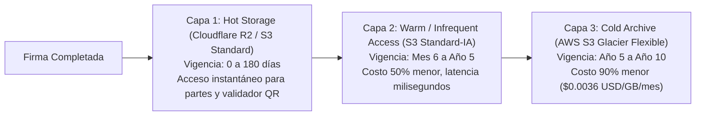

1. **Capa 1 (Hot Storage - Primeros 6 meses):**
   * El documento reside en almacenamiento de alta disponibilidad para descargas frecuentes de las partes y consultas al QR.
2. **Capa 2 (Warm Storage - 6 meses a 5 años):**
   * El archivo pasa a almacenamiento de acceso poco frecuente. El costo se reduce a la mitad y se mantiene accesible en milisegundos si un juez o banco lo requiere.
3. **Capa 3 (Cold Archive / Glacier - Año 5 al 10):**
   * Almacenamiento ultra-barato para custodia histórica de largo plazo (~$0.0036 USD por GB al mes).

---

#### B. Plazo de Retención Legal Obligatoria en Chile

En Chile, la duración obligatoria de la custodia de documentos viene fijada por las normas de **prescripción del Código Civil y Comercial**:

| Tipo de Instrumento | Plazo de Retención Recomendado | Fundamento Jurídico en Chile |
| :--- | :--- | :--- |
| **Contratos con Mérito Ejecutivo (Arriendos Ley 21.461, Deudas)** | **5 Años** | Art. 2515 Código Civil: La acción ejecutiva prescribe en 3 años y la acción ordinaria consecuencial en 2 años adicionales (total 5 años). |
| **Contratos Laborales y Finiquitos de Mutuo Acuerdo** | **5 Años** | Plazo de prescripción de acciones laborales e inspecciones previsionales (Art. 510 Código del Trabajo). |
| **Contratos Comerciales y Facturación** | **6 Años** | Art. 200 del Código Tributario: Plazo máximo de prescripción para fiscalizaciones del SII en caso de no declaración. |
| **Declaraciones Juradas Simples / Mudanzas / Poderes Cortos** | **2 Años** | Trámites administrativos de vigencia acotada. |

---

#### C. Arquitectura de Seguridad y Privacidad: Control de Acceso Cero-Confianza

Para garantizar que nadie no autorizado pueda acceder a los contratos, se implementa una arquitectura de **Cifrado de Extremo a Extremo y Acceso Restringido**:

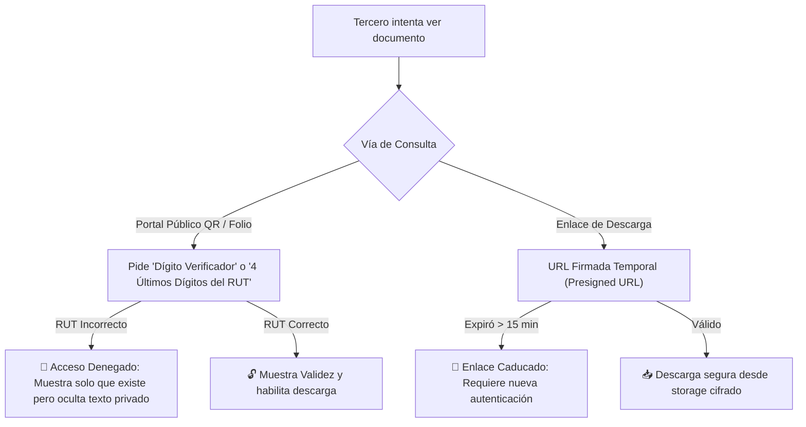

1. **Cifrado en Reposo (Encryption at Rest - AES-256):**
   * Cada archivo PDF y sus anexos se almacenan cifrados con el estándar militar **AES-256** mediante llaves gestionadas en AWS KMS / Cloudflare Key Management. Si alguien robara el disco duro del servidor, los archivos son totalmente ilegibles.
2. **Cifrado en Tránsito (TLS 1.3):**
   * Toda transferencia de datos hacia el navegador o hacia la API de IDOK se transmite bajo canales cifrados TLS 1.3 con certificados HSTS forzados.
3. **Descarga Exclusiva mediante URLs Firmadas Temporales (Presigned URLs):**
   * El archivo PDF **jamás tiene una URL pública estática** (ej: `sinnotario.cl/uploads/arriendo.pdf` está terminantemente prohibido).
   * Cuando un usuario autenticado o un validador legítimo solicita la descarga, el servidor genera una **URL criptográfica temporal que expira en 15 minutos**. Pasado ese tiempo, el enlace queda inservible.
4. **Barrera de Privacidad en el Validador QR ("PIN de Seguridad / RUT Challenge"):**
   * Si una persona cualquiera encuentra un papel botado o escanea el QR por curiosidad:
     * La pantalla pública desplegará el **Sello Verde de Validez**, confirmando que el folio `SN-2026-9842` es auténtico y legal.
     * **Pero los datos sensibles (monto de la renta, nombres completos, texto del contrato) están anonimizados con asteriscos** (ej: `J*** P*** - RUT: 12.345.***-*`).
     * Para descargar el PDF íntegro o ver los datos sensibles, el validador exige un **Desafío de Identidad**: *"Ingrese los 4 últimos dígitos del RUT de cualquiera de los firmantes"*.
   * Esto impide que extraños descarguen contratos ajenos usando simplemente una foto del QR.
5. **Aislamiento Multitenant y Cadena de Custodia Inmutable:**
   * La base de datos registra en un *Audit Log* inmutable cada intento de acceso, IP, fecha, hora y dispositivo que abrió o descargó el documento, protegiendo a la empresa ante requerimientos judiciales.

---

#### D. Recuperación de Documentos a Largo Plazo: ¿Cómo accede un cliente a su contrato 1, 2 o 5 años después?

Un caso de uso sumamente común es que un arrendatario o propietario necesite recuperar su contrato de arriendo **1 o 2 años después** para un juicio de desalojo, un trámite bancario, la restitución de la garantía o una postulación a subsidios, habiendo borrado los correos originales o cambiado de teléfono celular.

Para resolver esto sin fricción ni dependencia de claves complejas que la gente olvida, **SinNotario.cl** implementa **tres vías de recuperación inmediata**:

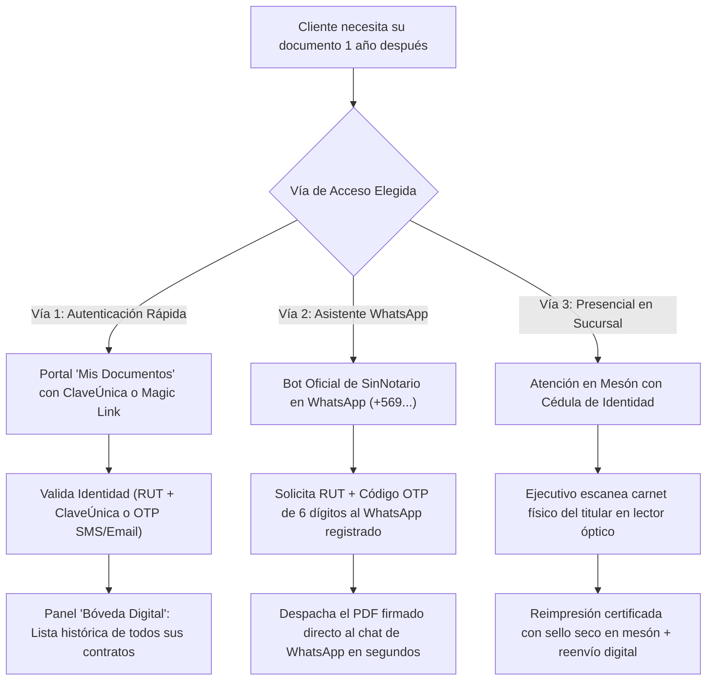

1. **Vía 1: Portal Web de Autoatención ("Mi Bóveda Documental") en `sinnotario.cl/mis-documentos`:**
   * **Sin Contraseñas Tradicionales (Passwordless):** El usuario no necesita recordar una clave creada hace un año.
   * **Ingreso con ClaveÚnica:** Pulsa *"Ingresar con ClaveÚnica"*. El Estado valida su identidad y el sistema abre de inmediato su **Bóveda Personal**, donde aparecen listados cronológicamente todos los contratos donde su RUT figure como arrendador, arrendatario, aval o trabajador.
   * **Ingreso Alternativo (Magic Link / SMS OTP):** Si no tiene su ClaveÚnica a mano, ingresa su RUT y recibe un enlace de acceso directo a su correo o un código SMS de 6 dígitos.
2. **Vía 2: Recuperación Instantánea por WhatsApp Oficial de SinNotario:**
   * El cliente escribe a nuestro WhatsApp oficial: *"Hola, necesito mi contrato de arriendo del año pasado"*.
   * El bot valida su RUT y envía un desafío de seguridad (código OTP). Una vez verificado, el sistema le adjunta el archivo PDF original firmado en el mismo chat en menos de 30 segundos.
3. **Vía 3: Recuperación Presencial en Sucursal Física:**
   * El cliente acude al mesón de cualquiera de nuestras sucursales y presenta su cédula de identidad física.
   * El ejecutivo pasa la cédula por el lector óptico, confirma la titularidad del requirente y le entrega en el acto una **reimpresión oficial en papel de seguridad con sello seco en relieve** y reenvío digital a su nuevo número o correo.

---

### 3.8 Módulo 8: Especificación Técnica de Arquitectura, Stack de Desarrollo, Storage Cloud y Conectores de Integración

Para asegurar que el desarrollo de **SinNotario.cl** sea de **alta velocidad, bajo costo operativo, máxima compatibilidad con el hosting actual y alineado con la infraestructura probada de Keystone Advisors**, se define la siguiente arquitectura técnica de sistemas:

---

#### A. Stack Tecnológico y Lenguaje de Programación

Considerando que el dominio `sinnotario.cl` se encuentra actualmente sobre **Hostinger (Servidor LiteSpeed con soporte nativo de PHP y bases de datos MySQL/MariaDB y SQLite)**, idéntico al ecosistema de alta estabilidad y velocidad utilizado en **KeyHub**:

1. **Lenguaje Backend: PHP 8.2+ (Arquitectura RESTful Modular / KeyHub Standard):**
   * **Por qué conviene:**
     * **Cero costo de infraestructura adicional:** Despliegue nativo directo en el servidor actual de Hostinger / LiteSpeed sin necesidad de contratar VPS costosos ni contenedores Docker complejos en etapas iniciales.
     * **Rendimiento LiteSpeed (LSCache):** En combinación con LiteSpeed Web Server, PHP 8 ejecuta consultas y APIs con tiempos de respuesta bajo los 80ms.
     * **Madurez en PDF y Criptografía:** Disponibilidad de librerías maduras como `FPDF`, `TCPDF` o wrappers de `wkhtmltopdf` / `Dompdf`, manejo nativo de `OpenSSL` (firmas digitales PKCS#7 y hash SHA-256) y soporte nativo de cURL para APIs de pago e identidad.
2. **Capa Frontend: HTML5 Semántico + TailwindCSS / CSS3 + Vanilla JS Modular (ES6+):**
   * **Por qué conviene:**
     * Sin la sobrecarga ni fragilidad de dependencias pesadas de frameworks como React o Angular para el portal público.
     * Carga ultrarrápida (Core Web Vitals óptimos para SEO y Google Ads).
     * Módulos interactivos en JavaScript puro: cálculo de cuotas, validación de RUT en vivo (módulo 11) y previsualizador PDF integrado con `PDF.js`.
3. **Base de Datos: MariaDB / MySQL (en Hostinger) o SQLite / PostgreSQL:**
   * MariaDB transaccional para gestión de usuarios, catálogo de plantillas, órdenes de pago, estados de firma y *Audit Log* forense.

---

#### B. Storage Cloud: Qué Contratar y Dónde Guardar los Documentos

Para el almacenamiento masivo y seguro de los contratos finales firmados, **la recomendación técnica definitiva es Cloudflare R2 (o AWS S3 como alternativa)**:

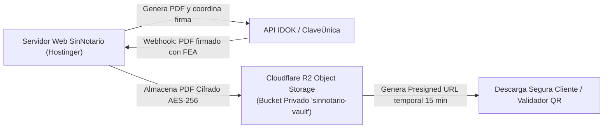

1. **¿Por qué Cloudflare R2 antes que AWS S3 estándar?**
   * **Cero Costo de Egreso (Zero Egress Fees):** AWS S3 cobra por cada Gigabyte que los usuarios descargan (egress data transfer). **Cloudflare R2 no cobra nada por el tráfico de descarga**. Si 100.000 personas escanean el QR o descargan sus contratos, el costo de red es **\$0 USD**.
   * **Tarifa de Almacenamiento Ultra-Económica:** \$0.015 USD por GB al mes (los primeros 10 GB son gratis para siempre). Guardar 50.000 contratos al año cuesta menos de **\$0.30 USD mensuales**.
   * **Compatibilidad 100% S3-API:** R2 utiliza el estándar de la API de Amazon S3, por lo que se conecta en PHP usando el AWS SDK oficial (`Aws\S3\S3Client`).
2. **Qué se debe contratar/crear:**
   * Una cuenta en **Cloudflare** (plan gratuito o Pro).
   * Activar **Cloudflare R2** y crear un Bucket privado: `sinnotario-vault-prod`.
   * Habilitar cifrado automático en reposo (**Server-Side Encryption with Cloudflare Managed Keys - AES-256**).
   * Generar las credenciales API: `R2_ACCESS_KEY_ID`, `R2_SECRET_ACCESS_KEY` y `R2_ENDPOINT_URL`.

---

#### C. Catálogo de Conectores Técnicos a Desarrollar (Capa de Integración)

Para estructurar un código modular, desacoplado y mantenible, el backend de SinNotario se organizará en **6 conectores (Adapters / Services)** especializados:

```text
api/
├── adapters/
│   ├── IdokSignatureAdapter.php       (Conector con IDOK / FirmaYa / ClaveÚnica)
│   ├── FintocPaymentAdapter.php       (Conector de Open Banking / Transferencias)
│   ├── WebpayPlusAdapter.php          (Conector Transbank / Tarjetas Web)
│   ├── StorageR2Adapter.php           (Conector Cloudflare R2 / AWS S3)
│   ├── WhatsAppNotificationAdapter.php(Conector WhatsApp Business API)
│   └── GeminiLegalAiAdapter.php       (Conector de Inteligencia Artificial Legal)
```

| Conector / Adaptador | Protocolo / SDK | Función Técnica Específica |
| :--- | :--- | :--- |
| **1. `IdokSignatureAdapter`** | REST HTTP / Webhook HMAC | • Envío de PDF en Base64 con metadata de firmantes (`POST /api/v1/documents`).<br/>• Recepción y validación de Webhook con firma HMAC (`POST /api/webhooks/idok`).<br/>• Descarga del PDF sellado con estampa X.509 y Código CVE. |
| **2. `FintocPaymentAdapter`** | REST API / Webhook | • Creación de sesión de cobro directo cuenta a cuenta (`PaymentIntent`).<br/>• Conciliación bancaria en tiempo real (abono inmediato a cuenta corriente). |
| **3. `WebpayPlusAdapter`** | Transbank SDK PHP Oficial | • Creación de transacción de tarjetas crédito/débito (`create`).<br/>• Confirmación y commit de la transacción (`commit`) y captura de código de autorización. |
| **4. `StorageR2Adapter`** | AWS SDK for PHP (S3 Client) | • Subida de archivos cifrados con `putObject`.<br/>• Generación de **Presigned URLs** temporales de 15 minutos con `createPresignedRequest` para descargas seguras. |
| **5. `WhatsAppNotificationAdapter`** | Evolution API v2 (Gateway Keystone / Baileys) | • **Aprovecha el gateway existente de Keystone Advisors** (`http://5.183.9.148:8080`) conectando una línea dedicada de WhatsApp Business/Personal mediante escaneo de código QR (idéntico a KeyHub).<br/>• Cero costo de plantillas por mensaje de Meta Cloud API.<br/>• Despacho automático de enlaces de firma interactivos, recordatorios con botón rápido y entrega directa del PDF final adjunto en el chat (`sendMedia` / `sendDocument`).<br/>• Permite respuesta bidireccional inmediata para que el usuario dialogue con un asesor humano en caso de dudas. |
| **6. `GeminiLegalAiAdapter`** | Google Gemini API (Interactions/REST) | • Extracción y análisis de texto del PDF para el motor `Smart Legal Check`.<br/>• Detección de cláusulas de escrituras públicas solemnes y sugerencias no vinculantes bajo el prompt blindado. |

---

### 3.9 Módulo 9: SinNotario Empresas & RRHH (Emisión Masiva de Contratos, Anexos y Firma en Lote)

El segmento B2B (empresas con personal en terreno, retail, construcción, seguridad, logística, servicios transitorios y pymes) representa el **mayor volumen de recurrencia y flujo de caja mensual predecible**. 

Una empresa que contrata 50 personas al mes o que debe emitir 300 anexos de jornada (como la adaptación a la Ley de 40 Horas o anexos de teletrabajo) no puede llenar formularios web uno por uno. Para ellos, **SinNotario.cl** incorpora la suite **`SinNotario Empresas`**:

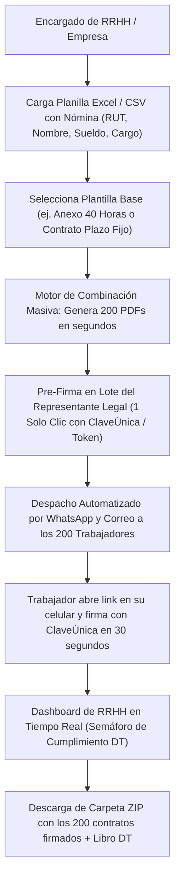

---

#### A. Las 4 Funcionalidades Clave para Recursos Humanos (RRHH)

1. **Carga Masiva por Planilla Excel / CSV (Bulk Generation):**
   * El encargado de personal descarga una plantilla Excel modelo de SinNotario con las columnas de su empresa: `RUT_TRABAJADOR`, `NOMBRE`, `EMAIL`, `TELEFONO`, `CARGO`, `SUELDO_BASE`, `DIRECCION`.
   * Sube el archivo Excel a la plataforma. El sistema valida los RUTs chilenos (módulo 11) en segundos y genera de golpe los 50, 100 o 500 contratos individuales listos para firmar.

2. **Firma en Lote del Representante Legal ("Batch Signing con 1 Solo Clic"):**
   * **El gran dolor de los gerentes:** En otras plataformas, el representante legal tiene que poner su ClaveÚnica o clave 100 veces seguidas (una por cada trabajador).
   * **Nuestra Solución:** El Representante Legal revisa la nómina completa y pulsa **"Aprobar y Firmar los 100 Documentos en Lote"**. Ingresa **una sola vez** su ClaveÚnica o PIN de seguridad y el sistema estampa su Firma Electrónica Avanzada en los 100 documentos en segundo plano.

3. **Despacho Omnicanal Automatizado (WhatsApp + SMS + Email):**
   * A través de nuestro gateway de WhatsApp de Keystone (costo \$0), cada trabajador recibe un mensaje personalizado:
     > *"Hola Carlos, tu empresa Inversiones Keystone te ha enviado tu nuevo **Anexo de Contrato (Ley 40 Horas)** para firma digital.  
     > 👉 Firma aquí en 1 minuto con tu ClaveÚnica: `sinnotario.cl/sign/anx-8942`"*
   * El trabajador en faena, bodega o terreno abre el link en su smartphone, se autentica con su ClaveÚnica y firma en 30 segundos sin imprimir papeles ni perder horas de trabajo.

4. **Tablero de Control de RRHH en Tiempo Real (Live Tracking & Recordatorios):**
   * El equipo de personal visualiza un dashboard tipo embudo:
     * 🟢 **Firmados (85%):** Documento archivado automáticamente.
     * 🟡 **Pendientes (15%):** Botón *"Reenviar recordatorio masivo por WhatsApp a pendientes"*.
     * 🔴 **Rechazados / Observados:** Con el motivo indicado por el trabajador (ej. *"mi sueldo acordado era otro"*).

---

#### B. Cumplimiento con la Dirección del Trabajo (DT) y Registro Electrónico

La legislación laboral chilena (Ley N° 21.327 de Modernización de la Dirección del Trabajo) exige que los contratos y anexos se registren en el portal de la DT:
* **Generación del Reporte CSV para la DT:** SinNotario genera automáticamente el archivo con el formato exacto que exige el portal *Mi DT* para el registro obligatorio de contratos laborales.
* **Carpeta Electrónica por Trabajador:** Cada empleado tiene su expediente digital con su contrato primitivo, anexos, comprobantes de vacaciones y finiquito, accesible para auditorías laborales en cualquier momento.

---

#### C. Modelo Comercial B2B (Monetización por Bolsas y Suscripciones Recurrentes)

Para capturar a estas empresas se implementan dos esquemas de contratación flexibles:

| Plan B2B | Volumen Mensual | Costo por Firma | Características Incluidas |
| :--- | :--- | :--- | :--- |
| **Bolsa Prepago Pyme** | 50 a 100 firmas | **$1.990 CLP** + IVA | Carga masiva por Excel, despacho por WhatsApp y soporte prioritario. Sin caducidad mensual de firmas. |
| **Plan Corporativo RRHH** | 101 a 500 firmas | **$1.490 CLP** + IVA | Firma en lote del representante legal en 1 clic, branding con logo de la empresa, reportes DT y exportación masiva. |
| **Plan Enterprise / Faenas** | +1.000 firmas / mes | **$990 a $1.200 CLP** | Integración API directa con su software de RRHH (Talana, Buk, Rex+, Defontana) y ejecutivo de cuenta dedicado. |

#### D. Arquitectura de Interfaces Web para Empresas y Matriz de Perfiles de Usuario (RBAC)

Para atender a empresas de forma profesional y segura, **SinNotario.cl** incorpora un portal corporativo dedicado en **`/empresas`** con separación estricta de roles, permisos y vistas (Control de Acceso Basado en Roles - RBAC):

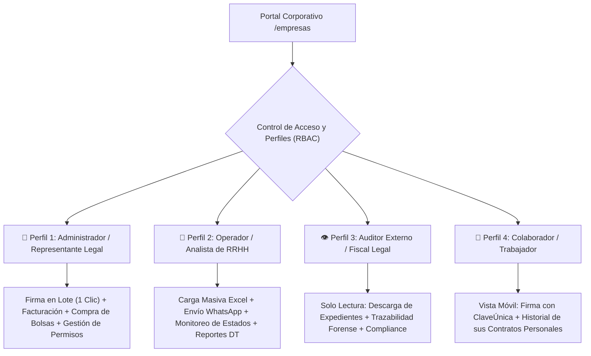

---

##### 1. Matriz de Perfiles y Permisos (RBAC)

| Módulo / Acción en Sistema | 👑 Admin / Rep. Legal | 👔 Operador RRHH | 👁️ Auditor / Fiscal | 👷 Colaborador |
| :--- | :---: | :---: | :---: | :---: |
| **Carga de Planilla Excel / Generación** | ✅ Total | ✅ Total | ❌ Sin acceso | ❌ Sin acceso |
| **Firma en Lote con ClaveÚnica (FEA)** | ✅ Exclusivo | ❌ Bloqueado | ❌ Sin acceso | ❌ Sin acceso |
| **Disparo de Enlaces por WhatsApp** | ✅ Permitido | ✅ Permitido | ❌ Sin acceso | ❌ Sin acceso |
| **Monitoreo de Embudo (Firmados/Pendientes)**| ✅ Total | ✅ Total | ✅ Solo Lectura | ❌ Sin acceso |
| **Exportación de Reporte para la DT (CSV)** | ✅ Permitido | ✅ Permitido | ✅ Solo Lectura | ❌ Sin acceso |
| **Compra de Bolsas / Facturas / Pagos** | ✅ Exclusivo | ❌ Bloqueado | ❌ Sin acceso | ❌ Sin acceso |
| **Ver / Firmar su Contrato Personal** | ❌ (Solo firma empresa) | ❌ | ❌ | ✅ Exclusivo |

---

##### 2. Especificación de Pantallas e Interfaces Web Corporativas

###### Pantalla A: Dashboard Principal de RRHH (`/empresas/dashboard`)
* **KPIs en Tiempo Real:** 
  * Tarjetas métricas: `Contratos Activos`, `Tasa de Firma en <24 hrs (ej: 89%)`, `Firmas Restantes en Bolsa`, `Alertas de Vencimiento de Plazo Fijo`.
* **Embudo Visual de Cumplimiento:**
  * Barra de progreso interactiva dividida en tres colores:
    * 🟢 **142 Firmados** (Listos para descargar).
    * 🟡 **28 Pendientes** (Con indicador de último recordatorio enviado).
    * 🔴 **3 Rechazados** (Con botón para leer el motivo del trabajador).
* **Acciones Rápidas:** Botón azul destacado `+ Cargar Nueva Nómina (Excel)` y botón `Reenviar Recordatorios a Pendientes`.

###### Pantalla B: Asistente de Carga Masiva ("Smart Bulk Wizard" en `/empresas/nuevo-lote`)
* **Paso 1 (Subida):** Zona drag-and-drop para arrastrar el archivo `.xlsx` o `.csv`, con enlace a la plantilla oficial de SinNotario.
* **Paso 2 (Mapeo y Validación):** El sistema escanea las filas y muestra un pre-chequeo automático:
  * *"150 filas detectadas: 148 RUTs válidos | 2 RUTs con error de dígito verificador corregibles en pantalla"*.
* **Paso 3 (Selección de Plantilla y Canales):**
  * Desplegable: *Contrato Indefinido*, *Anexo 40 Horas*, *Reglamento Interno*.
  * Casillas: `[ X ] Despachar por WhatsApp` `[ X ] Despachar por Correo Electrónico`.

###### Pantalla C: Bandeja de Firma en Lote del Representante Legal (`/empresas/firma-lote`)
* **Diseñada para el Gerente General / Representante Legal:**
  * Tabla resumen con los contratos pendientes de su firma corporativa.
  * Selector global `[ Marcar Todos (150) ]`.
  * Visualizador rápido de muestra para auditar 2 o 3 contratos al azar sin abrirlos todos.
  * **Botón Maestro de Acción:**
    > 🔐 **Aprobar y Firmar 150 Documentos con mi ClaveÚnica**  
    > *(Abre la pasarela segura de IDOK. El representante ingresa su contraseña y su 2FA una sola vez, y el motor estampa la Firma Electrónica Avanzada en los 150 contratos de forma paralela en segundo plano).*

###### Pantalla D: Expediente del Trabajador y Reportes DT (`/empresas/colaboradores`)
* Buscador por nombre o RUT de empleado.
* Despliega la **Carpeta Digital del Trabajador**:
  * Ficha personal + Contrato Primitivo + Anexos ordenados cronológicamente + Comprobantes de entrega de EPP o Reglamento Interno.
* **Botón "Exportar Libro DT":** Descarga directa del archivo comprimido con la codificación requerida por el portal de la Dirección del Trabajo para cumplir la Ley N° 21.327 sin multas.

#### E. Arquitectura Multi-Instancia de WhatsApp por Empresa (Instancias Dedicadas B2B)

Uno de los factores que más genera desconfianza y fricción en los trabajadores de una empresa es recibir contratos desde un número desconocido o genérico de un tercero. Si un operario de *Constructora Los Andes* recibe un WhatsApp de un número que dice *"SinNotario"*, suele pensar que es una estafa o phishing y no abre el enlace.

Para solucionar esto de raíz y ofrecer una experiencia **100% White-Label (Marca Blanca)** a costo marginal casi nulo, **SinNotario.cl** aprovecha la naturaleza **multi-instancia nativa de Evolution API v2** (la misma que ya opera en el gateway de Keystone Advisors):

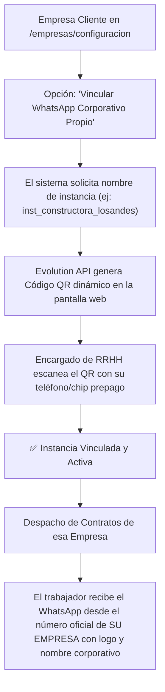

---

##### 1. Modelo de Implementación y Costo Marginal Cero
* **El Requisito Físico para la Empresa:**
  * Un simple **chip prepago** (costo ~$2.000 a $4.000 CLP en cualquier kiosko o supermercado, o eSIM) o una línea corporativa que la empresa ya posea.
  * El smartphone más básico y económico del mercado (o un dispositivo en desuso en la oficina de RRHH) conectado a WiFi.
* **El Proceso de Vinculación (Autoservicio en 30 Segundos):**
  1. En el panel de la empresa (`/empresas/configuracion/whatsapp`), el administrador pulsa **"Conectar mi propio WhatsApp de RRHH"**.
  2. El backend de SinNotario invoca a Evolution API (`POST /instance/create`) y despliega un **Código QR dinámico** en la pantalla del computador.
  3. El encargado de RRHH abre WhatsApp en su teléfono, entra a *Dispositivos Vinculados* y escanea el QR.
  4. La instancia queda enlazada en el gateway del servidor de Keystone (`http://5.183.9.148:8080`).

---

##### 2. Beneficios Comerciales y Psicológicos para el Negocio B2B
* **Confianza y Tasa de Apertura Inmediata (98%+):** Cuando el trabajador recibe la notificación, ve el nombre oficial de su empleador (ej: *"Recursos Humanos Constructora Los Andes"*), la foto de perfil corporativa y el número de la empresa. La tasa de firma dentro de las primeras 4 horas sube drásticamente.
* **Canal Directo de Dudas Internas:** Si el trabajador tiene una duda legítima (ej: *"¿por qué mi bono de colación viene en $45.000 en vez de $50.000?"*), responde directamente en ese chat y el mensaje llega al teléfono físico que tiene el equipo de RRHH en su escritorio. La empresa atiende a su propia gente sin intermediarios.
* **Modo Compartido / Fallback:** Para pymes pequeñas que no quieran comprar un chip ni vincular un teléfono, pueden optar por usar la **Instancia General de SinNotario** por defecto.

### 3.10 Módulo 10: Diseño Exhaustivo de la Arquitectura de Interfaces Web (UI/UX) y Mapa del Sitio

Con la madurez alcanzada en el modelo de negocio (autoatención web, atención presencial en sucursales, suite B2B masiva para empresas y motor de IA), se formaliza el **diseño de interfaz y experiencia de usuario (UI/UX)** para cada una de las vistas públicas y privadas de **SinNotario.cl**:

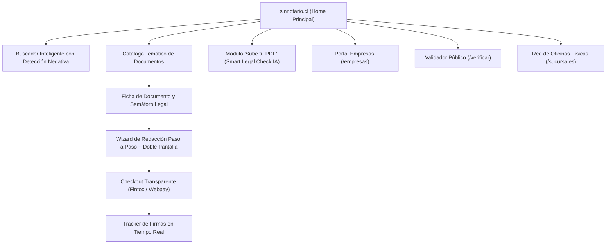

---

#### 1. Home Principal (`/`) — Propuesta de Valor, Búsqueda y Confianza

* **Header Superior Fijo (Sticky Navbar):**
  * **Izquierda:** Isotipo y Logotipo oficial de **SinNotario.cl**.
  * **Centro (Navegación):** `Trámites y Contratos`, `Empresas y RRHH`, `Validador QR`, `Oficinas Físicas`, `Preguntas Frecuentes`.
  * **Derecha (Accesos Directos):** Botón secundario `Mis Documentos` (acceso con ClaveÚnica) y botón primario azul corporativo `+ Nuevo Trámite`.
* **Hero Section (Zona de Alto Impacto):**
  * **Titular Principal:** *"Firma tus contratos y declaraciones 100% legal, sin filas ni notarías."*
  * **Bajada:** *"Al amparo de la Ley N° 19.799 con Firma Electrónica Avanzada (FEA) y ClaveÚnica. Válido en todo Chile. En línea o en nuestras oficinas presenciales."*
  * **Barra de Búsqueda Omnipresente (Smart Search):**
    * Placeholder: *"¿Qué trámite necesitas hacer hoy? (Ej: Contrato de arriendo, declaración de residencia, finiquito...)"*
    * **Comportamiento con Detección Negativa:** Si el usuario tipea *"compraventa de casa"* o *"salida de menor"*, se despliega de inmediato un modal educativo amarillo: *"⚠️ Este trámite exige Notaría presencial por ley. Te explicamos los requisitos aquí"*.
  * **Sellos de Confianza Visibles (Trust Badges):** Logotipos oficiales de *ClaveÚnica (Gobierno Digital)*, *Prestador Acreditado IDOK*, *Ley N° 21.461 Devuélveme mi Casa* y *Transbank / Fintoc*.
* **Bloque de Doble Entrada (Bifurcación Inmediata):**
  * **Tarjeta A:** *"Necesito redactar un documento desde cero"* (Lleva al catálogo guiado).
  * **Tarjeta B:** *"Ya tengo mi documento en PDF, solo quiero firmarlo"* (Lleva a la zona de carga con opción de diagnóstico IA).
* **Bloque "Nuestro Modelo Híbrido (Ven a Conocernos)":**
  * Sección destacada con mapa interactivo y fotografías del mesón y cabinas privadas: *"¿Te cuesta la tecnología o prefieres atención humana? Visita nuestras sucursales físicas: te ayudamos a redactar y firmar con asistencia personalizada"*.

---

#### 2. Ficha del Documento y Semáforo Legal (`/tramites/[slug]`)

* **Cabecera del Trámite:** Título formal (ej: *"Contrato de Arrendamiento con Mérito Ejecutivo"*).
* **Badge de Validez Jurídica:** 🟢 **100% Válido con ClaveÚnica (Ley 19.799 / Ley 21.461)**.
* **Caja de Preguntas Clave:**
  * ¿Para qué sirve? (Explicación ciudadana simple).
  * ¿Qué incluye? (Cláusulas de desalojo rápido, inventario, reajuste IPC, codeudor solidario).
  * ¿Quiénes deben firmar? (Arrendador y Arrendatario).
* **Calculador de Precios en Vivo:**
  * Tarifa transparente fija: `1 Documento + 2 Firmas FEA = $15.980 CLP`.
* **Botón de Conversión:** `Comenzar a Redactar Ahora (Toma 4 minutos)`.

---

#### 3. El Asistente de Redacción ("Smart Wizard" en 4 Pasos)

La pantalla se divide en un **diseño de dos columnas (Layout 60/40)**:
* **Columna Izquierda (60%): El Formulario Guiado por Pasos:**
  * **Paso 1: Datos de las Partes:**
    * Interruptor: `[ ] Persona Natural` | `[ ] Representante Legal de Empresa`.
    * Campos con autovalidación de RUT chileno en vivo (módulo 11).
  * **Paso 2: Condiciones del Contrato:**
    * Inmueble, canon de arriendo, garantía, periodicidad de reajuste (IPC trimestral/semestral).
  * **Paso 3: Cláusulas Especiales y Asistente IA:**
    * Opciones predefinidas (mascotas, subarriendo, número de cheques) o campo libre para que la IA adapte el texto.
  * **Paso 4: Canales de Notificación de los Firmantes:**
    * Teléfonos celulares para WhatsApp y correos electrónicos.
* **Columna Derecha (40%): El "Live Document Preview" (Previsualizador en Tiempo Real):**
  * A medida que el usuario digita a la izquierda, a la derecha se va renderizando el documento en una vista previa protegida en papel con marca de agua *"BORRADOR SIN FIRMAR"*.
  * Permite al cliente leer exactamente cómo va quedando su contrato antes de pagar.
* **Barra Flotante Inferior de Rescate Humano:**
  * Botón: `💬 ¿Dudas con este campo? Habla con un Asesor Humano en WhatsApp`.
  * Botón: `🏢 Guardar y Terminar en Sucursal Física`.

---

#### 4. Checkout Transparente y Sin Fricción (`/checkout/[folio]`)

* **Resumen de la Orden:**
  * Nombre del Instrumento: *Contrato de Arriendo - Folio SN-2026-9842*.
  * Desglose: Redacción de Plantilla + 2 Firmas Avanzadas con ClaveÚnica.
  * Total a pagar en pesos chilenos con IVA incluido.
* **Selector de Medios de Pago:**
  * ⚡ **Opción A (Recomendada): Transferencia Directa Fintoc** (*"Paga directo desde tu app bancaria sin comisiones"*).
  * 💳 **Opción B: Tarjetas de Débito / Crédito (Webpay Plus Transbank)** (*Redcompra, Visa, Mastercard en cuotas*).
* **Garantía Visible:** *"Si por alguna razón legal el documento no puede firmarse, te devolvemos el 100% de tu dinero"*.

---

#### 5. Tablero de Seguimiento de Firmas ("Live Tracker" post-pago)

Una vez confirmado el pago, el usuario no queda en el aire; la pantalla se transforma en un **Tracker de Seguimiento en Tiempo Real**:
* **Línea de Tiempo Visual:**
  * 🟢 **Paso 1:** Pago confirmado y contrato generado.
  * 🟢 **Paso 2:** Firma de Arrendador (Don Juan Pérez) — *Completada con ClaveÚnica hoy a las 10:15 hrs*.
  * 🟡 **Paso 3:** Firma de Arrendatario (Doña María Soto) — *Pendiente de firma*.
    * Indicador: *"Enlace enviado a su WhatsApp +569... hace 12 minutos"*.
    * Botón de acción: `📲 Reenviar Enlace de Firma por WhatsApp`.
  * ⚪ **Paso 4:** Cierre y Emisión de Copias Certificadas.
* **Acciones:**
  * `Descargar Borrador Oficial` | `Compartir Enlace de Seguimiento`.

---

#### 6. Portal de Validación Pública (`/verificar`)

* **Diseño Limpio, Sobrio e Institucional:**
  * Diseñado para que un receptor externo (juez, notario, funcionario municipal o banco) sienta máxima formalidad técnica.
* **Caja de Verificación Central:**
  * Pestaña 1: **Por Código de Folio** (`SN-2026-XXXX-XXXX`).
  * Pestaña 2: **Por Carga de Archivo PDF** (Arrastrar el archivo para cálculo forense de Hash SHA-256).
* **Resultado de la Validación:**
  * 🟢 **Tarjeta Verde de Autenticidad:** *"Documento Válido e Íntegro conforme a la Ley N° 19.799"*.
  * Detalle de sellos de tiempo TSA, certificador acreditado IDOK y listado de comparecientes anonimizado con desafío de seguridad (ingreso de últimos dígitos del RUT) para descarga del PDF original.

---

### 3.11 Módulo 11: Backend Administrativo y Consola de Configuración de la Plataforma (`/admin`)

Para garantizar la total independencia operativa, seguridad, auditoría de ingresos y gobernanza del negocio sin depender de modificaciones directas en base de datos o despliegues de código, **SinNotario.cl** incorpora una **Consola de Administración y Configuración Centralizada (`/admin`)**:

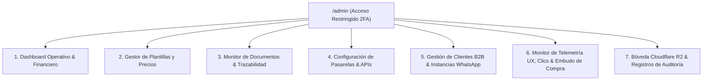

#### 1. Roles y Permisos de Acceso al Backend
El backend administrativo implementa control de acceso basado en roles (**RBAC**):
* **SuperAdmin (Keystone Directores):** Acceso total a finanzas, configuración de APIs, pasarelas de pago, llaves de cifrado y base de datos.
* **LegalAdmin (Equipo Jurídico):** Edición de cláusulas de plantillas, alertas legales, semáforos notariales y revisión de contratos observados.
* **Operaciones / Soporte:** Visualización de estado de documentos, reenvío manual de notificaciones WhatsApp/Email a firmantes y validación de órdenes de pago.
* **Auditor Externo / DT:** Acceso en modo solo lectura a logs forenses de firmas y sellos criptográficos.

---

#### 2. Módulos de la Consola de Configuración

##### A. Dashboard de Métricas en Tiempo Real (`/admin/dashboard`)
* **KPIs Clave:**
  * Facturación diaria/mensual acumulada (CLP).
  * Documentos emitidos vs. firmados vs. abandonados.
  * Tasa de conversión del embudo web.
  * Balance de firmas disponibles en el proveedor PSC (IDOK / FirmaYa).
  * Estado de conectividad de servicios externos (Cloudflare R2, Evolution API, Transbank/Flow).

##### B. Gestor de Catálogo, Precios y Plantillas (`/admin/templates`)
* **Editor Visual de Plantillas:**
  * Modificación de variables dinámicas (`{{ARRENDADOR_NOMBRE}}`, `{{CANON_ARRIENDO_CLP}}`, etc.).
  * Ajuste de precios base por documento y recargos por firmantes adicionales.
  * Activación / desactivación de plantillas con un solo clic.
  * Configuración del **Semáforo Legal** y textos de advertencia para usuarios.
  * Actualización del diccionario del **Detector Negativo de Trámites Exclusivos de Notaría** (palabras clave prohibidas y respuestas pedagógicas).

##### C. Monitor de Documentos y Bóveda Criptográfica (`/admin/documents`)
* Tabla maestra de todos los contratos y declaraciones procesadas:
  * Folio único (`SN-XXXX-XXXX`), Estado (`BORRADOR`, `PENDIENTE_PAGO`, `EN_FIRMAS`, `COMPLETADO`).
  * Enlace de descarga directa del PDF sellado desde Cloudflare R2 con verificación de hash SHA-256.
  * Botón de **Reenvío Express de Enlace de Firma** por WhatsApp o Correo en caso de que un firmante no lo haya recibido.
  * Registro de intentos de firma, direcciones IP, navegadores y estampas de tiempo TSA.

##### D. Configuración Global de Pasarelas y APIs (`/admin/settings`)
* **Pasarelas de Pago:**
  * Alternador de modo Sandbox / Producción para Transbank Webpay Plus y Flow.
  * Modificación segura de Códigos de Comercio y Secret Keys sin tocar archivos de servidor.
* **Proveedor de Firma Electrónica (PSC):**
  * Credenciales de API IDOK / Prestador acreditado.
  * Selección de tipo de firma por defecto: *Firma Electrónica Simple (FES con OTP)* o *Firma Electrónica Avanzada (FEA con ClaveÚnica)*.
* **Bóveda Cloudflare R2:**
  * Monitoreo de espacio utilizado en el bucket `sinnotario-vault-prod`.
  * Verificación de credenciales de API v4 y regeneración de llaves.
* **Gateway WhatsApp (Evolution API):**
  * Estado del contenedor de WhatsApp en `http://5.183.9.148:8080`.
  * Configuración de plantillas de mensajes interactivos con botones (ej: *"Presiona aquí para firmar tu contrato"*).

##### E. Consola de Clientes B2B, Instancias de WhatsApp y Parámetros Operativos (`/admin/companies` y `/admin/operations`)
* **Gestión de Instancias de WhatsApp por Empresa Cliente:**
  * Monitor de estado de conexión en tiempo real (`CONNECTED`, `CONNECTING`, `DISCONNECTED`) contra el gateway Evolution API (`http://5.183.9.148:8080`).
  * Generador de Código QR dinámico en pantalla para vincular o reconectar el chip prepago / línea de RRHH de cada cliente.
  * Selector de instancia fallback: si la línea de la empresa se desconecta por falta de batería o señal, el sistema conmuta automáticamente a la instancia de respaldo de SinNotario.cl para evitar frenar la operación.
  * Personalizador de mensajes de salida por empresa: saludo corporativo, nombre del remitente, logo en avatar y disparador de recordatorios automáticos (a las 24 hrs, 48 hrs y 72 hrs).
* **Gestor de Variables Operativas de la Plataforma (`/admin/system-variables`):**
  * **Tiempos de Caducidad y Expiración:** Plazo máximo de vigencia de enlaces de firma (ej: 72 horas por defecto) antes de archivar el trámite.
  * **Límites de Reintentos OTP / SMS:** Número máximo de envíos de códigos de seguridad por usuario para mitigar costos de SMS y ataques de fuerza bruta.
  * **Políticas de Retención en Bóveda R2:** Definición de periodos de custodia legal (mínimo 5 años para contratos civiles, 10 años para finiquitos y contratos laborales).
  * **Modo Mantenimiento y Pasarela de Acceso:** Interruptor global para activar/desactivar la pantalla de mantenimiento o limitar el acceso a IPs autorizadas durante actualizaciones en caliente.
  * **Parámetros de Correos Transaccionales (SMTP):** Configuración de servidor de correo saliente, remitente oficial (`notificaciones@sinnotario.cl`) y plantillas HTML con marca blanca.
  * **Tarifario Dinámico B2B:** Configuración de escalones de descuento por volumen (Tier 1: 1 a 50 firmas; Tier 2: 51 a 200 firmas; Tier 3: 201+ firmas).

##### F. Monitor de Telemetría UX, Mapas de Clics y Embudo de Conversión (`/admin/analytics-ux`)

Para optimizar de forma continua la tasa de conversión, detectar puntos de fricción o abandono y entender exactamente el comportamiento de los clientes, **SinNotario.cl** incorpora un **motor de telemetría propio, privado y liviano (sin cookies de terceros ni degradación de velocidad)**:

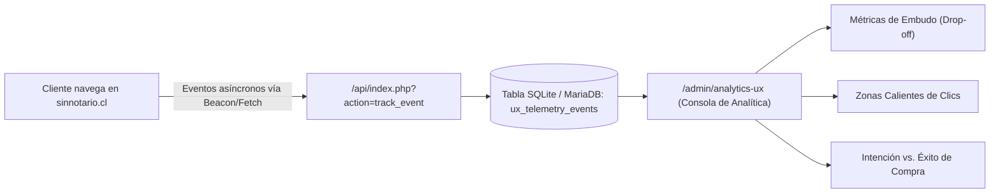

* **Eventos Monitoreados Automáticamente:**
  1. **Trazabilidad de Clics e Interacciones:** Registro anónimo del elemento pulsado (botón `Crear`, selector de categoría, enlaces de WhatsApp, botón de validar documento).
  2. **Términos de Búsqueda Frecuentes y Trámites Fallidos:** Registro de lo que los usuarios escriben en la barra inteligente (ej: qué porcentaje busca contratos de arriendo vs. finiquitos o trámites notariales exclusivos).
  3. **Medición de Intención de Compra (*Purchase Intent*):**
     * Apertura del modal rápido o inicio del Wizard 60/40 (`intent_contract_started`).
     * Avance por pasos: Paso 1 (Arrendador) ➔ Paso 2 (Arrendatario) ➔ Paso 3 (Inmueble) ➔ Paso 4 (Renta) ➔ Paso 5 (Checkout).
  4. **Tasa de Abandono por Paso (*Drop-off Rate*):** Identificación visual de en qué campo exacto o paso los usuarios abandonan el proceso (por ejemplo, si el abandono ocurre al solicitar el RUT del Aval o al llegar a la pasarela de pago).
  5. **Éxito de Compra (*Conversion Complete*):** Confirmación de pago exitoso vía Webpay/Fintoc y emisión efectiva del borrador cifrado.
  6. **Dispositivo y Rendimiento:** Resolución de pantalla, tipo de dispositivo (Móvil vs. Escritorio), navegador y tiempo promedio de completitud por trámite.

* **Visualizaciones en la Consola Administrativa (`/admin/analytics-ux`):**
  * **Gráfico de Embudo Interactivo (*Funnel Chart*):** Visitantes ➔ Búsqueda ➔ Selección de Plantilla ➔ Formulario Iniciado ➔ Datos Completos ➔ Pago Exitoso.
  * **Top 10 de Elementos Más Clickeados:** Listado jerárquico de botones y enlaces con su respectivo conteo y porcentaje.
  * **Ratio Intención vs. Éxito:** Porcentaje de usuarios que iniciaron un trámite y lograron finalizarlo con pago (KPI objetivo > 65%).
  * **Reporte de Búsquedas sin Coincidencia:** Alerta de trámites que los clientes buscan pero que aún no están disponibles en el catálogo para evaluar su creación.

##### G. Registro Forense de Auditoría (`/admin/audit-logs`)
* Bitácora inalterable de todos los eventos del sistema:
  * Intentos de inicio de sesión administrativo.
  * Cambios de configuración o precios.
  * Consultas públicas al validador `/verificar`.
  * Alertas de seguridad por intentos de fuerza bruta o discrepancia en sumas de verificación.

---

### 3.12 Módulo 12: Área Privada de Clientes y Portal de Autenticación (`/mi-cuenta`)

Para fidelizar a los usuarios, permitir el seguimiento de sus trámites en curso, consultar el historial de contratos firmados y descargar copias certificadas en cualquier momento sin costo, **SinNotario.cl** contempla un **Área Privada de Clientes ("Mi Bóveda Legal")**:

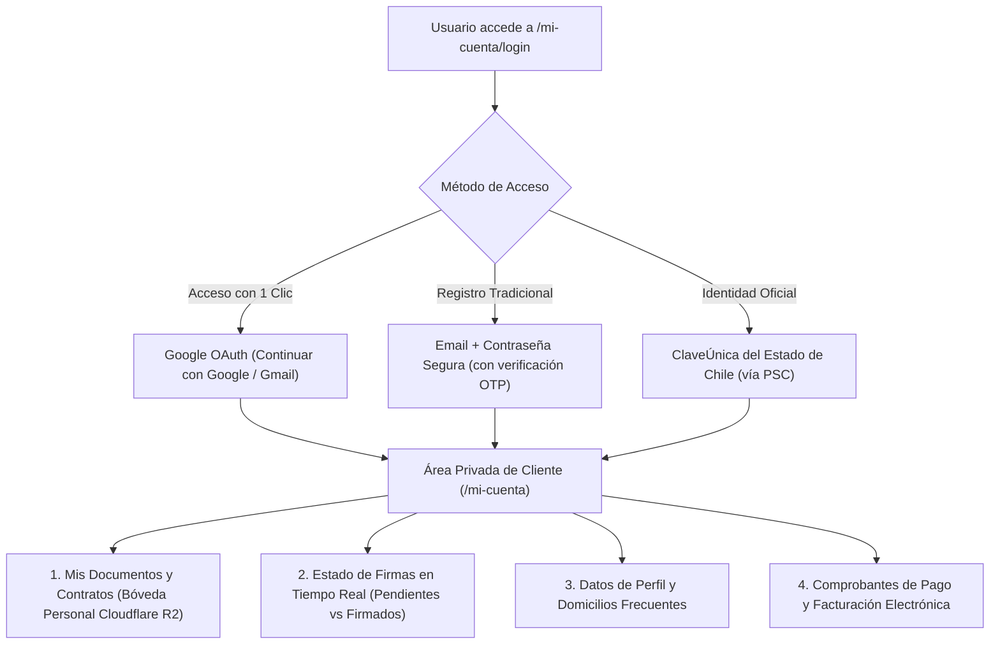

#### 1. Métodos de Inicio de Sesión y Alta de Usuario
* **Google Identity Services (OAuth 2.0 / Login con Google / Gmail):**
  * Acceso instantáneo en 1 solo clic aprovechando la sesión de Google del usuario.
  * Captura verificada de nombre, apellido, correo electrónico y foto de perfil.
  * Vinculación automática con los contratos emitidos previamente bajo ese mismo correo.
* **Registro Tradicional por Correo Electrónico:**
  * Formulario seguro con correo, contraseña cifrada con `bcrypt` (cost 12) y validación de correo mediante enlace tokenizado o código OTP de 6 dígitos.
* **Inicio de Sesión con ClaveÚnica (Acceso Cívico Oficial):**
  * Para trámites que requieran el máximo nivel de certeza de identidad civil sin necesidad de recordar contraseñas privadas.

#### 2. Funcionalidades del Portal Privado (`/mi-cuenta`):
* **Bóveda Personal de Contratos:**
  * Listado completo de documentos suscritos o en proceso, con búsqueda por contraparte, inmueble o fecha.
  * Botón de **Descarga Directa del PDF Oficial con sellos criptográficos**.
  * Botón de **Compartir Enlace de Verificación** para enviar a bancos, corredoras o juzgados.
* **Tracker Activo de Firmas:**
  * Indicador de quién ha firmado y quién está pendiente.
  * Botón: `🔔 Reenviar Recordatorio por WhatsApp / Email a la Contraparte`.
* **Plantillas Guardadas y Reutilización de Datos:**
  * Permite guardar datos recurrentes (ej: los datos del arrendador o empresa para no reescribirlos cada mes).
* **Gestión de Boletas y Facturas:**
  * Historial tributario de los pagos realizados en Webpay o Flow con descarga de comprobante electrónico emitido ante el SII.

---

### 3.13 Módulo 13: Motor de Facturación Electrónica Automática SII (Boletas y Facturas DTE)

Conforme a la normativa del **Servicio de Impuestos Internos (SII)** de Chile (Resolución Exenta N° 74/2020 y complementarias sobre obligatoriedad de boletas y facturas electrónicas en línea), **SinNotario.cl** integra un motor automatizado de tributación electrónica en tiempo real que se dispara inmediatamente tras confirmarse el pago exitoso en la pasarela.

#### A. Interfaz de Decisión Tributaria en el Checkout ("¿Boleta o Factura?")

Previo a efectuar el pago (tanto en el Wizard de Redacción 60/40 como en la Carga de PDF Propio o contratación B2B), la interfaz presenta de forma obligatoria el selector de comprobante legal:

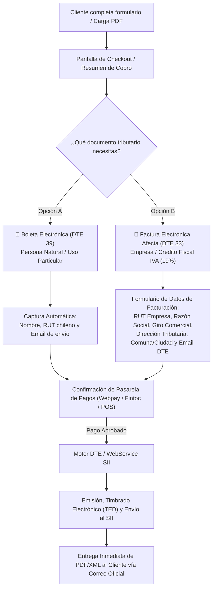

* **Modalidad Boleta Electrónica (DTE 39):**
  * Diseñada para personas naturales.
  * Si el usuario se encuentra autenticado (mediante Google o Email), el sistema pre-completa su RUT y Correo Electrónico.
  * El monto cobrado incluye el 19% de IVA desglosado internamente en el XML del SII.
* **Modalidad Factura Electrónica Afecta (DTE 33):**
  * Diseñada para empresas o personas con iniciación de actividades de 1ª Categoría que necesitan aprovechar el crédito fiscal del servicio legaltech.
  * Campos obligatorios validados en cliente y servidor:
    1. **RUT Empresa:** Con validación algorítmica Módulo 11 y formato oficial `XX.XXX.XXX-X`.
    2. **Razón Social:** Nombre legal registrado ante el SII.
    3. **Giro Comercial:** Actividad económica tributaria.
    4. **Dirección Tributaria:** Calle y número fiscal.
    5. **Comuna y Ciudad:** Mapeo homologado con el catálogo geográfico del SII.
    6. **Correo de Intercambio DTE:** Casilla de correo inscrita para recibir los archivos XML y PDF de la factura.

#### B. Arquitectura Técnica de Emisión y Conexión con el SII

El sistema soporta una arquitectura dual de despacho tributario:

1. **Integración vía API DTE Certificada (Ruta Rápida y de Alta Resiliencia):**
   * Conexión REST a proveedor homologado ante el SII (ej: LibreDTE, SimpleBoleta, Haulmer/OpenFactura).
   * Al recibir el webhook `payment_approved`, el backend ejecuta un `POST /api/dte/emit` con el payload JSON del cobro.
   * El proveedor firma digitalmente el documento con certificado tributario, genera el **Timbre Electrónico del SII (TED / Código de Barras Bidimensional PDF417)** y lo reporta de forma asíncrona a las bases del SII (`palena.sii.cl`).
   * Retorna al instante la URL pública del PDF timbrado y el archivo XML legal.
2. **Conexión Directa al WebService del SII (Arquitectura Propietaria):**
   * Utiliza el Certificado Digital del Representante Legal (`.pfx` / `.p12`) almacenado con cifrado AES-256 en variables del servidor.
   * Obtención del Token de Sesión (`getSeed` y `getToken` con firma XML-DSig).
   * Consumo de folios desde el archivo CAF (Código de Autorización de Folios) asignado por el SII a la sociedad titular de SinNotario.
   * Generación y firma del Envelope SOAP hacia los servidores de producción del SII.

#### C. Bóveda Tributaria en el Área Privada de Clientes (`/mi-cuenta`)
* En la pestaña **"Mis Facturas y Boletas"**, el cliente dispone de una tabla histórica con el Folio tributario asignado por el SII, fecha de emisión, monto neto, IVA (19%), total cancelado y dos botones de acción inmediata:
  * `[ Descargar PDF Timbrado (TED) ]`
  * `[ Descargar XML Legal ]`

---

### 3.14 Módulo 14: Infraestructura de Correo Transaccional Oficial (Titan Mail SMTP & Casillas Operativas)

Para erradicar cualquier riesgo de falsificación de identidad (Spoofing), garantizar una tasa de entrega en bandeja de entrada principal superior al 99% y proyectar la máxima seriedad institucional, **SinNotario.cl** desacopla el despacho de correos de la función básica `mail()` de los servidores web y adopta una infraestructura corporativa **SMTP Socket Autenticado con Titan Mail**.

#### A. Definición de Casillas de Operación del Ecosistema

| Casilla Oficial | Protocolo / Propósito | Uso en la Plataforma |
| :--- | :--- | :--- |
| **`notificaciones@sinnotario.cl`** | **SMTP Saliente Automatizado (Daemon)** | **Casilla operativa principal del sistema.** Despacho automático de enlaces de firma, códigos de seguridad (OTP), alertas de nuevos comparecientes, entrega de contratos definitivos timbrados y boletas/facturas electrónicas del SII. |
| **`contacto@sinnotario.cl`** | **Atención y Respuesta (Inbound/Outbound)** | Casilla configurada en el encabezado `Reply-To` de todos los correos transaccionales para que si un cliente presiona "Responder", su consulta llegue al equipo de operaciones y ejecutivos legales. |
| **`soporte@sinnotario.cl`** | **Mesa de Ayuda y Post-Venta** | Canal formal para consultas de validación de identidad, incidencias técnicas con ClaveÚnica o solicitudes de rectificación. |
| **`legal@sinnotario.cl`** | **Visación y Asesoría Humana** | Canal exclusivo para la revisión de contratos por parte de abogados titulados y emisión de certificados de fe de firma presencial en sucursales. |

#### B. Especificación del Cliente SMTP Socket (`KeystoneSmtpClient`)

El servicio de correos se implementa en PHP puro de alto rendimiento ([`src/Services/KeystoneSmtpClient.php`](file:///Users/rodrigo/Documents/Antigravity/Keystone%20Advisors/SinNotario/src/Services/KeystoneSmtpClient.php)) sin requerir librerías pesadas de terceros:
* **Conexión Cifrada SSL:** Conexión directa mediante sockets `ssl://smtp.titan.email:465` (con fallback a TLS en puerto 587).
* **Autenticación Fuerte:** Handshake con protocolo `AUTH LOGIN` en Base64.
* **Firma de Encabezados MIME:**
  * `From: SinNotario.cl <notificaciones@sinnotario.cl>`
  * `Reply-To: contacto@sinnotario.cl`
  * `X-Mailer: SinNotario-Enterprise-Mailer/2.0`
  * `Message-ID` criptográfico único por cada correo despachado.
* **Soporte de Adjuntos Binarios:** Capacidad para incrustar el PDF final con firma electrónica y el DTE del SII en Base64 con encabezados `Content-Disposition: attachment`.
* **Alineación DNS de Ciberseguridad (SPF, DKIM y DMARC):**
  * Registro **SPF**: `v=spf1 include:spf.titan.email ~all` autorizando a Titan Mail como emisor legítimo.
  * Llave **DKIM** de 2048 bits firmando cada cuerpo de correo.
  * Registro **DMARC**: `p=quarantine; rua=mailto:dmarc-reports@sinnotario.cl` para bloquear cualquier intento externo de suplantación de la marca.

#### C. Gestión Administrativa Visual en Tiempo Real (`/admin`)

Desde la Consola de Administración ([`admin.php`](file:///Users/rodrigo/Documents/Antigravity/Keystone%20Advisors/SinNotario/admin.php)), los directores pueden supervisar y modificar en caliente sin alterar código:
* Servidor SMTP Host y Puerto activo.
* Usuario y contraseña del buzón operativo.
* Dirección de correo y nombre del remitente visual.
* Logs detallados de cada intento de conexión SMTP con códigos de retorno (`250 OK`, `354 Enter mail`, `235 Auth successful`).

---

### 3.15 Módulo 15: Suite de Inteligencia Financiera, Control de Costos de Firma y Conciliación Bancaria (`/admin/finanzas`)

Para garantizar la rentabilidad unitaria por documento, proyectar el flujo de caja, controlar con precisión quirúrgica las obligaciones por pagar con los Prestadores de Servicios de Certificación (PSC de Firma Electrónica) y conciliar cada peso recaudado contra la cartola de la cuenta corriente bancaria de Keystone Advisors SpA, **SinNotario.cl** incorpora un **Módulo de Inteligencia Financiera de Acceso Restringido**.

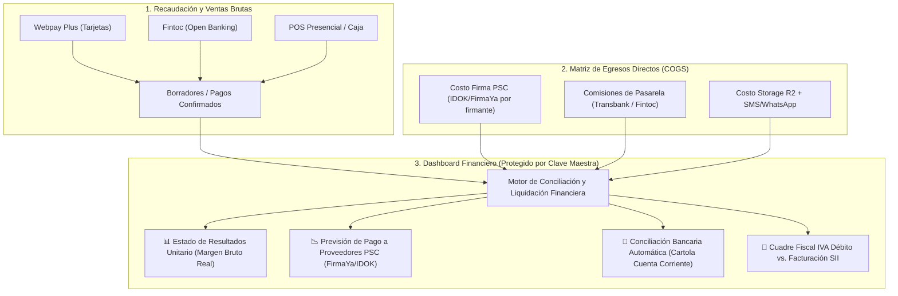

#### A. Control de Acceso y Blindaje de Seguridad Reforzado
* **Acceso de Nivel Directores (Dual-Lock):**
  * Para ingresar a `/admin/finanzas` o activar las vistas financieras de la consola, no basta con la sesión administrativa general.
  * Se exige una **segunda clave maestra de tesorería (PIN Financiero de 6 a 8 caracteres o confirmación OTP al correo del Director)**.
  * La sesión financiera expira automáticamente tras **15 minutos de inactividad**.
  * Todas las consultas y exportaciones a Excel/CSV se asientan con marca de agua y hash en la bitácora inalterable de auditoría (`audit_logs`).

#### B. Dashboard de Ventas e Ingresos en Tiempo Real
1. **KPIs Financieros Clave:**
   * **Ventas Brutas Totales (CLP):** Ingreso bruto acumulado (diario, semanal, mensual o rango personalizado).
   * **Ingresos Netos (Sin IVA):** Base gravable real de la compañía tras descontar el 19% de IVA de boletas y facturas.
   * **Ticket Promedio por Trámite:** Valor medio facturado por contrato (plantilla base + firmantes adicionales).
   * **Margen Bruto Unitario (% y $):** Ingreso Neto menos el costo directo de los firmantes convocados y la comisión de la pasarela.
2. **Desglose por Canal y Categoría:**
   * Comparativa de recaudación: **Canal Web (Autoatención)** vs. **Canal Sucursales Físicas (Caja)**.
   * Ventas por familia legal: Inmobiliario (Arriendos/Promesas) vs. Laboral (Finiquitos/Contratos) vs. Trámites Personales.
   * Método de pago preferente: % Cobrado por Transferencia Fintoc (menor comisión) vs. Débito/Crédito Webpay.

#### C. Control de Egresos y Liquidación de Proveedores de Firma (PSC / IDOK / FirmaYa)
Cada vez que un cliente suscribe un contrato con 2, 3 o 4 comparecientes, SinNotario genera un pasivo con el prestador acreditado de firma electrónica:
1. **Matriz de Costos por Tipo de Firma:**
   * **Costo FES (Firma Electrónica Simple con OTP/SMS):** Tarifa unitaria mayorista pactada con el PSC (ej. ~$450 a $650 CLP + IVA por firmante).
   * **Costo FEA (Firma Electrónica Avanzada con ClaveÚnica):** Tarifa unitaria mayorista pactada (ej. ~$1.200 a $1.800 CLP + IVA por firma avanzada).
2. **Monitor de Obligaciones Devengadas por Pagar:**
   * Contador exacto de firmas consumidas en el mes en curso segregadas por proveedor y modalidad.
   * **Monto Total a Desembolsar:** Cálculo automático de la pre-factura que emitirá el proveedor (IDOK/FirmaYa) a fin de mes.
   * Alerta preventiva de saldo o límite de paquete de firmas para evitar que los clientes queden bloqueados en el portal por agotamiento de cupo mayorista.

#### D. Motor de Conciliación Bancaria Automática (Cuadre con Cuenta Corriente)
Uno de los mayores dolores de cabeza operativos es cruzar lo que dice el portal web con el dinero real depositado en el banco:
1. **Importador de Cartolas Bancarias (CSV / Excel / Open Banking):**
   * El administrador de finanzas arrastra el extracto de movimientos de la cuenta corriente de Keystone Advisors SpA (Banco Santander, Banco de Chile, BancoEstado o Bci).
2. **Algoritmo de Conciliación a 3 Vías:**
   * **Vía 1: Transbank Webpay Plus:**
     * Cruza el Código de Autorización y Folio de Transbank con el abono consolidado en la cartola bancaria a las 24/48 hrs hábiles (descontando la comisión de 1,49% débito / 2,29% crédito).
   * **Vía 2: Transferencias Fintoc:**
     * Conciliación 1 a 1 en tiempo real gracias al identificador único de transferencia bancaria de la cartola.
   * **Vía 3: Recaudación en Efectivo / POS Sucursal:**
     * Cuadre de cierres de caja diarios de los ejecutivos presenciales contra las boletas de depósito bancario.
3. **Semáforo de Conciliación:**
   * 🟢 **Conciliado:** El monto cobrado en el portal coincide exactamente con el abono bancario neto.
   * 🟡 **Pendiente de Abono:** Transacción aprobada en Webpay pero aún dentro del ciclo de retención de 24/48 hrs del adquiriente.
   * 🔴 **Discrepancia / Contragolpe:** Diferencia de montos o anulación no cuadrante que requiere investigación de tesorería.

#### E. Cuadre Tributario y Previsión de IVA F29
* Reporte consolidado para el contador de Keystone Advisors:
  * Total de **Débito Fiscal IVA (19%)** generado por las Boletas Electrónicas (DTE 39) y Facturas (DTE 33) emitidas.
  * Desglose de **Crédito Fiscal IVA** recuperable proveniente de las facturas de costos de Transbank, Fintoc, IDOK y Cloudflare.
  * Estimación anticipada del impuesto mensual a declarar en el Formulario 29 ante el SII.

---

## 4. Modelo Híbrido: Plataforma Digital + Oficina Física

### 4.1 Por qué una Oficina Física (Resolución de Brechas)
En Chile existe un segmento masivo de la población que desconfía de las transacciones 100% online, no posee computador o desconoce el manejo de su ClaveÚnica. La oficina física de **SinNotario** humaniza la tecnología y derriba las barreras de adopción.

### 4.3 Especificación Detallada del Flujo de Atención Presencial y Sistema de Habilitación Post-Pago en Caja

El modelo operativo de **SinNotario.cl** se sustenta en dos grandes canales de negocio complementarios:
1. **Canal Autoatención Web (100% Online):** El usuario ingresa desde su casa u oficina, redacta con plantillas o IA, paga en línea mediante Webpay/Fintoc y se disparan los enlaces de firma remota.
2. **Canal Presencial en Sucursal (Atención Asistida + Habilitación Post-Pago en Caja):** Diseñado para usuarios con brecha digital, operaciones donde ambas partes asisten al local, o clientes que buscan la confianza de un espacio físico con asesoría.

A continuación se detalla paso a paso la experiencia presencial y el **mecanismo de habilitación y desbloqueo seguro de las estaciones de firma tras el pago en caja**:

---

#### A. Flujo de Atención Paso a Paso en Sucursal

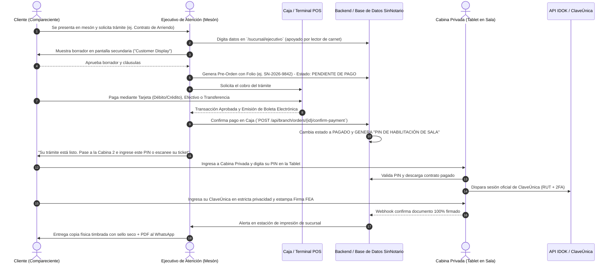

---

#### B. Mecanismo de Habilitación y Desbloqueo Post-Pago en Estaciones de Firma

Para evitar el uso no autorizado de certificados de firma digital (que conllevan costo por API con IDOK), **ninguna estación ni cabina privada permite firmar sin una confirmación previa de pago registrado en caja**:

1. **Generación de la Pre-Orden Bloqueada:**
   * El ejecutivo prepara el documento en el sistema. El expediente queda en estado `DRAFT_PENDING_PAYMENT`.
   * En este estado, el sistema **no** consume la API de IDOK ni genera certificados.

2. **Cobro en la Caja de Sucursal:**
   * La caja admite **Tarjeta de Débito/Crédito (Transbank / Redelcom / SumUp)**, **Efectivo** o **Transferencia Bancaria directa**.
   * Una vez recibido el pago, el cajero presiona **"Cobro Confirmado"**, lo que emite la boleta electrónica de servicios y actualiza el expediente a `PAID_AUTHORIZED`.

3. **Mecanismo de Desbloqueo y Flexibilidad de Firma (Cabina Privada O Dispositivo Móvil del Cliente):**
   * El sistema de caja genera un **Ticket de Activación** impreso y despachado por WhatsApp que le da al cliente **libertad total para elegir cómo y dónde firmar**:
     * **Canal A: En la Cabina Privada de la Sucursal (Tablet Kiosko):** Ideal para usuarios sin teléfono inteligente, sin batería o que buscan la asistencia guiada del anfitrión en la sala. La tablet lee el QR del ticket o recibe el PIN de 4 dígitos y carga el documento al instante.
     * **Canal B: En el Dispositivo Móvil Propio del Cliente (BYOD - Bring Your Own Device):** Ideal para quienes prefieren la comodidad y privacidad de su propio celular, donde ya tienen guardadas sus claves biométricas (Face ID / Huella), navegadores y aplicaciones de autenticación 2FA.
       * El cliente simplemente **escanea el código QR del ticket con la cámara de su smartphone** o **abre el enlace instantáneo recibido en su WhatsApp**.
       * Se abre la aplicación web de firma optimizada para móviles, firma con su ClaveÚnica desde su propio teléfono sentado cómodamente en la sala de espera de la sucursal, y el sistema central detecta la firma en tiempo real.

4. **Firma Privada Asistida en Cabina:**
   * La tablet muestra el contrato en formato táctil de alta legibilidad.
   * El cliente pulsa el botón verde **"Firmar con ClaveÚnica"**.
   * Se abre la pasarela segura del Estado: el cliente digita su contraseña de ClaveÚnica y su código 2FA recibido en su teléfono.
   * **Política de Cero Registro de Claves:** El software de la tablet opera en entorno aislado; jamás almacena ni tiene acceso a las credenciales privadas del usuario.

5. **Recepción, Impresión y Despacho:**
   * En cuanto la tablet detecta la respuesta exitosa de la API de IDOK, la cabina felicita al cliente y se bloquea automáticamente borrando memoria temporal (*auto-logout* para el siguiente usuario).
   * En el mesón del ejecutivo salta una alerta acústica y visual: *"Expediente SN-2026-9842 firmado exitosamente"*.
   * La impresora de seguridad imprime la copia física foliada. El anfitrión le aplica el timbre seco en relieve, le entrega su carpeta institucional y el sistema despacha el archivo PDF final y el link de verificación QR directo al WhatsApp del cliente.

Para materializar con éxito la atención presencial, la plataforma SinNotario no se limita a un sitio web de cara al público, sino que incorpora **interfaces y perfiles de sistema especializados para el personal de sucursal** y una **infraestructura de hardware seguro en salas privadas**.

#### A. Módulo de Ejecutivo de Atención (`/sucursal/ejecutivo`)
Interfaz optimizada para operación en mesón con alta velocidad de digitación y atención al cliente presencial:
* **Buscador Rápido de Clientes por RUT:** Permite consultar si el cliente ya está registrado en el sistema, historial de trámites previos o si comparece por primera vez.
* **Formulario Asistido Ultrarrápido:** El ejecutivo digita los datos del requirente mientras este le dicta o le entrega su cédula de identidad:
  * Lector óptico de cédula de identidad para captura automática de RUT, nombres y número de documento (evitando errores tipográficos).
  * Inyección en tiempo real de condiciones contractuales especiales acordadas verbalmente en el mesón.
* **Previsualización en Doble Pantalla:** La estación del mesón cuenta con un monitor secundario orientado al cliente ("Customer Facing Display"), donde el usuario va leyendo el contrato en tiempo real a medida que el ejecutivo lo redacta.
* **Módulo de Caja y Medios de Pago Presenciales:**
  * Cobro integrado mediante POS Transbank / SumUp presencial, transferencia bancaria instantánea o efectivo con emisión de boleta electrónica de servicios en el acto.
* **Disparador Inmediato de Firma:** Con un solo clic, el ejecutivo puede:
  1. Enviar el enlace de firma remota al WhatsApp del cliente o de la contraparte que no pudo asistir.
  2. **Transferir la sesión a una "Cabina de Firma Privada" en la sucursal.**

---

#### B. Cabinas y Dispositivos de Firma Privada en Sala (`/sucursal/estacion-firma`)
Para garantizar la privacidad, la protección de datos personales y la tranquilidad del cliente (especialmente personas mayores o con poca afinidad tecnológica), la sucursal dispondrá de **Salas / Cabinas Privadas de Firma Digital Asistida**:

* **Hardware en Sala:**
  * **Tablets / All-in-One táctiles montados en soporte de seguridad ergonómico en modo Kiosko (Kiosk Mode):** El dispositivo solo ejecuta la aplicación de firma segura de SinNotario, con bloqueo de barra del sistema, teclado virtual protegido y reinicio de sesión automático al terminar.
  * **Cámara de Alta Resolución con Aro de Luz:** Para captura biométrica facial en caso de enrolamiento o prueba de vida activa.
  * **Lector de Huella Dactilar / Lector de Chip de Cédula:** Para validaciones de identidad alternativas a ClaveÚnica.
* **Flujo de Firma Guiada con Acompañamiento:**
  * El cliente ingresa a la sala privada acompañado o asesorado por el anfitrión de la sucursal.
  * La pantalla de la tablet muestra: *"Hola Juan, confirma los términos de tu Contrato de Arriendo antes de firmar"*.
  * El cliente revisa las cláusulas haciendo scroll táctil.
  * El sistema le solicita autenticarse con su **ClaveÚnica oficial del Estado** o mediante biometría asistida.
  * **Blindaje de Privacidad:** En el momento exacto en que el usuario digita su contraseña de ClaveÚnica o recibe su código 2FA en el teléfono, la interfaz bloquea la visibilidad a terceros o el asesor se retira un paso, garantizando que sus claves nunca queden expuestas.
  * Una vez estampada la Firma Electrónica Avanzada (FEA), la pantalla emite un sonido de confirmación y muestra el código QR de cierre.

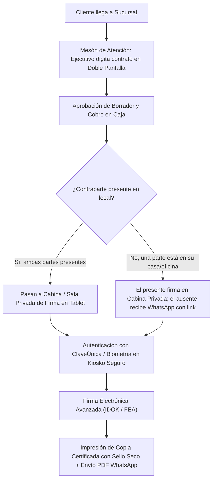

---

#### C. Módulo de Sala de Abogados y Asesoría Jurídica (`/sucursal/abogado`)
Para situaciones complejas, discrepancias entre arrendador y arrendatario, o contratos atípicos (reconocimientos de deuda, convenios de liquidación, acuerdos de confidencialidad o sociedades):
* **Bandeja de Interconsultas en Vivo:** El ejecutivo de mesón puede derivar un caso a la "Bandeja de Abogado de Turno".
* **Dashboard Jurídico Especializado:**
  * El abogado visualiza el borrador generado por el ejecutivo, efectúa correcciones directas de cláusulas y redacta adendas jurídicas a la medida.
* **Sala de Reuniones Privada (Consultoría):**
  * Las partes pasan a la oficina del abogado de SinNotario, quien les explica el alcance legal de lo que van a firmar, resuelve dudas y actúa como facilitador legal del acuerdo.
* **Autorización Jurídica con Firma:** El abogado puede añadir una cláusula de *"Revisado y Visado Jurídicamente por Keystone Advisors / SinNotario"*, otorgando el máximo estándar de tranquilidad a las partes.

---

#### D. Estación de Impresión de Seguridad y Certificación Física
Para clientes que exigen llevarse el documento en papel físico para presentarlo ante conserjerías, bancos o juzgados que aún operan con carpetas:
* Impresora láser de alta resolución conectada al sistema central.
* **Papel de Seguridad Foliado:** Papel con marca de agua institucional de SinNotario.
* **Estampado de Seguridad:** Sello seco en relieve (embossing) institucional con timbre de goma de cotejo y código QR visible de gran tamaño en la primera y última hoja para verificación digital instantánea con cualquier smartphone.

### 4.3 Flujo Operativo del Cliente en Sucursal

```mermaid
flowchart LR
    A["Recepción / Tótem de Turnos"] --> B["Mesón de Atención y Digitación"]
    B --> C["Previsualización del Contrato"]
    C --> D["Validación y Firma Digital (ClaveÚnica o Biometría)"]
    D --> E{"¿Requiere Abogado?"}
    E -- "Sí" --> F["Interconsulta en Sala Legal"]
    E -- "No" --> G["Emisión Inmediata"]
    F --> G
    G --> H["Envío a WhatsApp/Email + Entrega Copia Impresa con QR"]
```

---

## 5. Blindaje Legal y Mitigación de Riesgos

### 5.1 Validez bajo la Ley N° 19.799
* Los documentos emitidos con Firma Electrónica Avanzada (FEA) gozan por mandato legal de la **misma presunción de autoría y fuerza probatoria que un instrumento privado otorgado ante notario** (Artículos 4 y 5).
* En contratos de arrendamiento, la Ley N° 21.461 ("Devuélveme mi casa") reconoce expresamente el mérito ejecutivo expedito cuando se celebran con FEA.

### 5.2 Mitigación de Riesgos Notariales (Código Orgánico de Tribunales)
* **Principio Rector:** La plataforma no es ministro de fe ni notaría pública, sino un intermediario tecnológico y prestador de servicios jurídicos privados.
* **Disclaimer Obligatorio (Web y Oficinas):**
  > *"SinNotario es una plataforma tecnológica y de asesoría jurídica privada que facilita la redacción y suscripción de contratos mediante Firma Electrónica al amparo de la Ley N° 19.799. No somos una Notaría Pública ni otorgamos fe pública notarial."*

### 5.3 Catálogo Taxativo de Documentos: Permitidos por Ley vs. Reservados a Notaría

Uno de los pilares de transparencia y seguridad jurídica de **SinNotario.cl** es informar de manera explícita, pedagógica y preventiva al cliente **qué documentos sí puede firmar en la plataforma con total validez legal** y **cuáles están estrictamente prohibidos o reservados por ley a una notaría tradicional**.

#### A. Documentos que SÍ se pueden firmar en SinNotario.cl (100% Válidos por Ley)
Al amparo de la **Ley N° 19.799** (Firma y Documentos Electrónicos), el **Código Civil** (autonomía de la voluntad en contratos consensuales) y la **Ley N° 21.461**, estos documentos gozan de plena validez jurídica, valor probatorio y mérito ejecutivo ante tribunales cuando se firman con Firma Electrónica Avanzada (FEA):

| Categoría | Documento Específico | Tipo de Firma Requerida | Marco Legal y Mérito |
| :--- | :--- | :--- | :--- |
| **Inmobiliario** | **Contrato de Arriendo de Inmuebles** (Casas, Dptos, Locales) | **FEA (Obligatoria)** | **Ley N° 21.461 ("Devuélveme mi casa")**: Otorga mérito ejecutivo y desalojo expedito. |
| **Inmobiliario** | Contrato de Subarriendo y Cesión de Arriendo | FEA | Validez plena contractual civil. |
| **Inmobiliario** | Acta de Entrega / Recepción de Inmueble y Llaves | FES o FEA | Respaldo de estado material de la propiedad. |
| **Inmobiliario** | Carta de Término / Desahucio de Contrato de Arriendo | FEA | Notificación fehaciente con fecha y autoría. |
| **Inmobiliario** | **Promesa de Compraventa Privada** | FEA | Válida al tenor del Art. 1554 del Código Civil (no transfiere dominio, solo promete). |
| **Laboral** | **Contrato Individual de Trabajo** y Anexos (Teletrabajo, Jornada) | FES o FEA | Dictámenes de la Dirección del Trabajo (DT) autorizan firma electrónica. |
| **Laboral** | Carta de Aviso de Término de Contrato de Trabajo | FEA | Comunicación laboral fehaciente. |
| **Laboral** | **Finiquito Laboral de Mutuo Acuerdo** | **FEA** | Válido ante la DT si las partes ratifican de mutuo acuerdo con FEA acreditada. |
| **Comercial / Pyme** | **Contrato de Prestación de Servicios Profesionales / Honorarios** | FES o FEA | Art. 1437 y 1438 Código Civil. |
| **Comercial / Pyme** | **Acuerdo de Confidencialidad (NDA)** | FES o FEA | Plena fuerza obligatoria entre las partes. |
| **Comercial / Pyme** | **Reconocimiento de Deuda y Convenio de Pago en Cuotas** | **FEA** | Título ejecutivo con mérito probatorio directo. |
| **Comercial / Pyme** | Cesión de Derechos Personales y Créditos | FEA | Notificación y aceptación contractual válida. |
| **Comercial / Pyme** | Contrato de Asociación o Cuentas en Participación | FEA | Código de Comercio chileno. |
| **Personales / Trámites** | **Declaración Jurada Simple de Residencia** | FES o FEA | Aceptada por municipalidades, bancos, trabajos y beneficios sociales. |
| **Personales / Trámites** | Declaración Jurada de Ingresos (para arriendos o créditos) | FES o FEA | Respaldo privado de solvencia. |
| **Personales / Trámites** | Declaración y Autorización de Mudanza (Salvoconducto privado) | FES o FEA | Declaración ante copropiedades y conserjerías. |
| **Personales / Trámites** | **Poder Especial / Mandato Privado** (ej. retirar encomiendas, trámites no solemnes) | FEA | Código Civil Art. 2116. |
| **Personales / Trámites** | Autorización de Uso de Propiedad (Domicilio tributario simple) | FEA | Utilizado comúnmente ante el SII. |

---

#### B. Catálogo Exhaustivo de Documentos que NO se pueden firmar en SinNotario.cl (Verificado en Vivo vs. DocLegal & Ley Chilena)

A partir de la inspección técnica directa de las plataformas de referencia (particularmente el registro de exclusiones de *DocLegal.cl*) y del Código Civil, Código de Comercio y leyes especiales, la siguiente tabla consolida **la totalidad de actos y trámites no válidos sin notaría**, agrupados por familia jurídica para advertir al usuario:

| Familia de Trámite | Trámite Específico Excluido | Motivo Legal de Exclusión |
| :--- | :--- | :--- |
| **Inmobiliario & Propiedad** | **Compraventa de Bienes Raíces (Casas/Terrenos)** | Art. 1801 inc. 2° Código Civil: Exige solemnidad de Escritura Pública. |
| **Inmobiliario & Propiedad** | **Hipotecas y Gravámenes sobre Inmuebles** | Art. 2409 Código Civil: Solemnidad de Escritura Pública. |
| **Inmobiliario & Propiedad** | **Contrato de Arriendo para Inscripción en CBR** | Si va a inscribirse en el Registro de Hipotecas y Gravámenes para oponibilidad a terceros acreedores hipotecarios (Art. 1962 CC), exige Escritura Pública. *(El arriendo estándar privado sí es 100% válido).* |
| **Inmobiliario & Propiedad** | **Autorización para Enajenar Inmuebles Conyugales** | Art. 1749 Código Civil: Autorización de la mujer casada en sociedad conyugal exige Escritura Pública o comparecencia personal ante Notario. |
| **Inmobiliario & Propiedad** | **Renuncia a Gananciales** | Solemnidad legal reservada a Escritura Pública. |
| **Vehículos & Tránsito** | **Compraventa o Transferencia de Vehículos** | Art. 35 Ley de Tránsito: Exige contrato autorizado ante Notario o Registro Civil. |
| **Vehículos & Tránsito** | **Mandatos/Poderes para Vender o Transferir Vehículos** | El Registro Civil rechaza mandatos privados para cambio de titularidad en el RNVM. |
| **Vehículos & Tránsito** | **Autorización para Salida de Vehículos al Extranjero** | El Servicio Nacional de Aduanas exige poder notarial protocolizado para paso fronterizo. |
| **Vehículos & Tránsito** | **Poderes para Retiro de Patente o Vehículo en Corrales** | Custodia Metropolitana y Direcciones de Tránsito exigen mandato notarial presencial. |
| **Familia & Personales** | **Autorización de Salida de Menores del País** | Ley de Menores y PDI: Exclusivo ante Notario Público o Registro Civil. |
| **Familia & Personales** | **Testamentos Solemnes (Abiertos o Cerrados)** | Art. 1011 Código Civil: Requiere presencia obligatoria de Notario y testigos hábiles. |
| **Familia & Personales** | **Reconocimiento de un Hijo** | Art. 187 Código Civil: Exige Escritura Pública o comparecencia ante el Registro Civil. |
| **Familia & Personales** | **Posesión Efectiva y Mandatos para Tramitarla** | La tramitación intestada ante el Registro Civil o testada ante tribunales exige patrocinio y poderes notariales. |
| **Familia & Personales** | **Mandato para Contraer Matrimonio Civil** | Ley de Matrimonio Civil exige Escritura Pública con designación expresa de los contrayentes. |
| **Laboral & Previsión** | **Carta de Renuncia Voluntaria del Trabajador** | Art. 177 Código del Trabajo: Exige ratificación ante ministro de fe (Notario, Inspector del Trabajo o dirigente sindical). |
| **Laboral & Previsión** | **Finiquito Laboral sin Mutuo Acuerdo / Cobro por Terceros** | Poderes para cobro de finiquito ante empleadores o cobro de pensiones en AFP exigen mandato notarial. *(Nota: El Finiquito de mutuo acuerdo con FEA sí es válido según DT).* |
| **Bancario & Financiero** | **Pagarés y Letras de Cambio Autorizados** | Ley N° 18.092: Para tener mérito ejecutivo directo como título de crédito debe autorizarse la firma ante Notario. |
| **Bancario & Financiero** | **Mandatos y Poderes Bancarios** | Los bancos rechazan poderes privados para apertura de cuentas, giros o endeudamiento comercial. |
| **Bancario & Financiero** | **Contrato de Mutuo Hipotecario o Mutuo Solemne** | Exige protocolización o escritura pública. |
| **Corporativo & Societario** | **Constitución/Modificación de Sociedades Tradicionales** | Exige Escritura Pública e inscripción en el Registro de Comercio del CBR. |
| **Electoral & Público** | **Declaraciones Juradas para el SERVEL o Candidaturas** | Ley Electoral exige ratificación ante Notario Público. |
| **Internacional** | **Documentos para Apostilla o Legalizaciones Consulares** | Cancillería exige que el documento provenga de ministro de fe público para ser apostillado. |

---

#### C. Mecanismo de Alerta y Guía Preventiva en la Plataforma (UX Anti-Confusión)
Para cumplir con las normas del **SERNAC (Ley del Consumidor)** y garantizar que ningún usuario gaste dinero por error:
1. **Buscador Inteligente con Detección Negativa:** Si un usuario busca en el catálogo términos como *"salida de menor"*, *"compraventa de casa"*, *"hipoteca"* o *"transferencia de auto"*, el sistema no muestra error vacío, sino una **tarjeta informativa de advertencia**:
   > ⚠️ **Este trámite no se puede realizar por internet sin notario.**  
   > *Por mandato de la ley chilena (Código Civil / Ley de Tránsito), este acto requiere Escritura Pública notarial o comparecencia ante el Registro Civil. No te dejes engañar por páginas que prometen esto online. Te explicamos qué necesitas y cómo hacerlo en el canal oficial.*
2. **Semáforo Legal en la Ficha del Documento:** Cada plantilla visible en SinNotario incluye un badge claro:
   * 🟢 **100% Válido con ClaveÚnica (Sin Notaría)** — Explicación de la ley aplicable.
   * 🔵 **Requiere Asesoría Legal Previa** — Recomendado revisar con nuestro abogado en sucursal.
3. **Filtro Preventivo en Carga de PDF Propios:** Si el cliente sube un documento propio con palabras clave de escrituras públicas solemnes, el sistema activa una confirmación donde el usuario debe declarar que conoce que su documento es un instrumento privado.

### 5.5 Sección Oficial de Preguntas Frecuentes (FAQ): Validez Legal y Operación en SinNotario.cl

Basado en la auditoría técnica de los sitios de referencia (*DocLegal.cl* y *MuySimple.cl*), esta sección compila, adapta y fortalece las principales dudas de los usuarios y terceros respecto a la validez jurídica de los documentos firmados en **SinNotario.cl**:

#### 1. ¿Tienen validez legal los documentos firmados en SinNotario.cl?
**Sí, plena y total validez legal.** Los documentos suscritos a través de nuestra plataforma se rigen por la **Ley N° 19.799 sobre Documentos Electrónicos, Firma Electrónica y Servicios de Certificación**. Conforme a los Artículos 4 y 5 de dicha ley, los actos y contratos otorgados o celebrados por personas naturales o jurídicas suscritos mediante **Firma Electrónica Avanzada (FEA)** son plenamente válidos de la misma manera y producen los mismos efectos que los celebrados por escrito y en soporte de papel, teniendo el **mismo valor probatorio y presunción de autoría que un instrumento privado otorgado ante Notario Público**.

#### 2. ¿SinNotario.cl es una notaría en línea o reemplaza a un Notario Público?
**No. SinNotario.cl no es una notaría pública ni presta servicios de fe pública notarial.** Somos una plataforma tecnológica y de servicios jurídicos privados que permite a las personas y empresas celebrar acuerdos privados mediante Firma Electrónica Avanzada acreditada por el Estado de Chile. La ley chilena permite que la inmensa mayoría de los contratos cotidianos (como arriendos, declaraciones juradas, finiquitos de mutuo acuerdo y contratos laborales) se celebren válidamente entre privados sin necesidad de concurrir presencialmente a un oficio notarial.

#### 3. ¿Qué tipo de firma se utiliza en SinNotario.cl?
Utilizamos principalmente **Firma Electrónica Avanzada (FEA)** emitida por un Prestador de Servicios de Certificación (PSC) debidamente acreditado ante la Subsecretaría de Economía del Gobierno de Chile (como IDOK / BeTrust). La identidad de cada compareciente es verificada en tiempo real mediante la **ClaveÚnica oficial del Estado de Chile** con Segundo Factor de Autenticación (2FA) o validación biométrica oficial.

#### 4. ¿Qué necesito para firmar un documento en la plataforma?
Para firmar 100% en línea o en nuestras sucursales necesitas:
1. Ser mayor de 18 años.
2. Contar con cédula de identidad chilena vigente (RUT chileno).
3. Poseer **ClaveÚnica activa del Registro Civil / Gobierno Digital**.
4. Disponer de un teléfono celular o correo electrónico para recibir el código de seguridad o enlace de firma.
*(En caso de no recordar tu ClaveÚnica o no contar con dispositivo, puedes acudir a nuestras oficinas físicas para recibir atención y firma asistida con biometría).*

#### 5. ¿Sirve un contrato de arriendo firmado en SinNotario para desalojar a un arrendatario moroso?
**Sí, absolutamente.** Nuestros contratos de arriendo incorporan expresamente las cláusulas de sumisión a la **Ley N° 21.461 (conocida como "Ley Devuélveme mi casa")**, que modificó la Ley N° 18.101. Al estar firmado con Firma Electrónica Avanzada (FEA), el contrato cuenta con **mérito ejecutivo indubitado**, lo que permite demandar mediante el procedimiento monitorio exprés y solicitar el lanzamiento (desalojo con auxilio de la fuerza pública) en un plazo aproximado de 10 días corridos tras la notificación judicial sin oposición fundada.

#### 6. ¿Qué documentos NO puedo firmar en SinNotario.cl?
No son válidos para firmar de forma exclusivamente privada y digital aquellos actos que por mandato expreso de la ley exigen la solemnidad de **Escritura Pública** notarial o la intervención presencial de un Ministro de Fe estatal, tales como:
* Compraventa definitiva e hipotecas de bienes raíces (casas, dptos, terrenos).
* Autorización de salida de menores del país (exigida de forma excluyente por la PDI y Ley de Menores ante Notario o Registro Civil).
* Transferencia de vehículos motorizados (exigida ante Notario o Registro Civil según Ley de Tránsito).
* Testamentos solemnes abiertos o cerrados.
* Mandatos judiciales para litigar en tribunales.
* Cartas de renuncia voluntaria unilateral del trabajador (exigen ratificación ante Notario, Inspector DT o dirigente sindical).
*(Para estos trámites, SinNotario.cl te orientará y nuestros abogados podrán redactar las bases previas, pero la suscripción final deberá realizarse en el canal oficial).*

#### 7. ¿Cómo puede un tercero (banco, juzgado, municipalidad o corredor) comprobar que el documento es auténtico?
Cada documento emitido cuenta con un sistema de verificación pública en **`sinnotario.cl/verificar`**:
* **Escaneo de Código QR:** Cada página tiene un código QR único que al escanearse con cualquier teléfono inteligente despliega el certificado de validez en tiempo real.
* **Código de Folio Alfanumérico:** Ingresando el código impreso al pie (ej. `SN-2026-9842`).
* **Cálculo Forense de Hash SHA-256:** Cualquier persona puede subir el archivo PDF a nuestra web; el sistema calcula su huella digital y confirma si el texto es 100% idéntico al original o si fue adulterado.

#### 8. ¿Puedo firmar en la oficina física si no me manejo con internet o no tengo smartphone?
**Sí. Ese es el gran valor de nuestro modelo híbrido.** Si tienes dificultades con el computador o teléfono celular, puedes acudir a cualquiera de nuestras oficinas físicas. Un ejecutivo digitará el contrato por ti en el mesón de atención y podrás firmar en una **Cabina Privada con pantalla táctil asistida** o en tu propio teléfono si lo prefieres, llevándote en el acto una **copia impresa certificada con timbrado seco en relieve y sellos de seguridad**.

#### 9. ¿Qué pasa si una de las partes está en la sucursal y la otra en otra ciudad?
Nuestro sistema es totalmente omnicanal y flexible. El compareciente presente en la sucursal puede firmar en la cabina privada o en su celular tras el pago en caja, y para la contraparte ausente el sistema despachará automáticamente un enlace seguro por WhatsApp y correo electrónico para que firme desde su casa o trabajo en cualquier lugar de Chile o del extranjero.

#### 10. ¿Los tribunales de justicia aceptan estos documentos como prueba?
**Sí. Los tribunales chilenos aplican de forma obligatoria la Ley N° 19.799.** Al contar con Firma Electrónica Avanzada (FEA) acreditada, la ley presume por derecho que el documento fue firmado por el titular del RUT asociado a la ClaveÚnica y que el contenido no ha sido alterado desde el momento de la estampa criptográfica, invirtiendo la carga de la prueba en favor de la validez del contrato.

---

## 6. Roadmap de Implementación y Fases

| Fase | Plazo Estimado | Alcance Principal | Entregables Clave |
| :--- | :--- | :--- | :--- |
| **Fase 1: MVP Digital** | Meses 1 a 3 | Plataforma SaaS web, Catálogo base de 20 plantillas, Integración API ClaveÚnica (IDOK), Pasarela de pagos y Notificaciones WhatsApp. | Sitio web funcional, flujo de firma online operativo, verificación por QR. |
| **Fase 2: Sucursal Piloto** | Meses 4 a 6 | Apertura de la primera oficina física en ubicación comercial estratégica, instalación de tótems, enrolamiento biométrico presencial y servicio de asesoría legal en sala. | Oficina física operativa, módulo de caja y digitación en sucursal, atención presencial. |
| **Fase 3: Expansión y Red B2B** | Meses 7 a 12 | Nuevos puntos de atención en comunas clave, convenios corporativos con inmobiliarias, corredoras y pymes; franquicias del modelo híbrido. | Integración B2B, portal corporativo, red de sucursales. |

---

> 💡 *Este documento reside en `Keystone Advisors/SinNotario/docs/DISENO_FUNCIONAL_SINNOTARIO.md` y servirá como base directa para la arquitectura del código, la integración de APIs y el diseño de la plataforma.*

